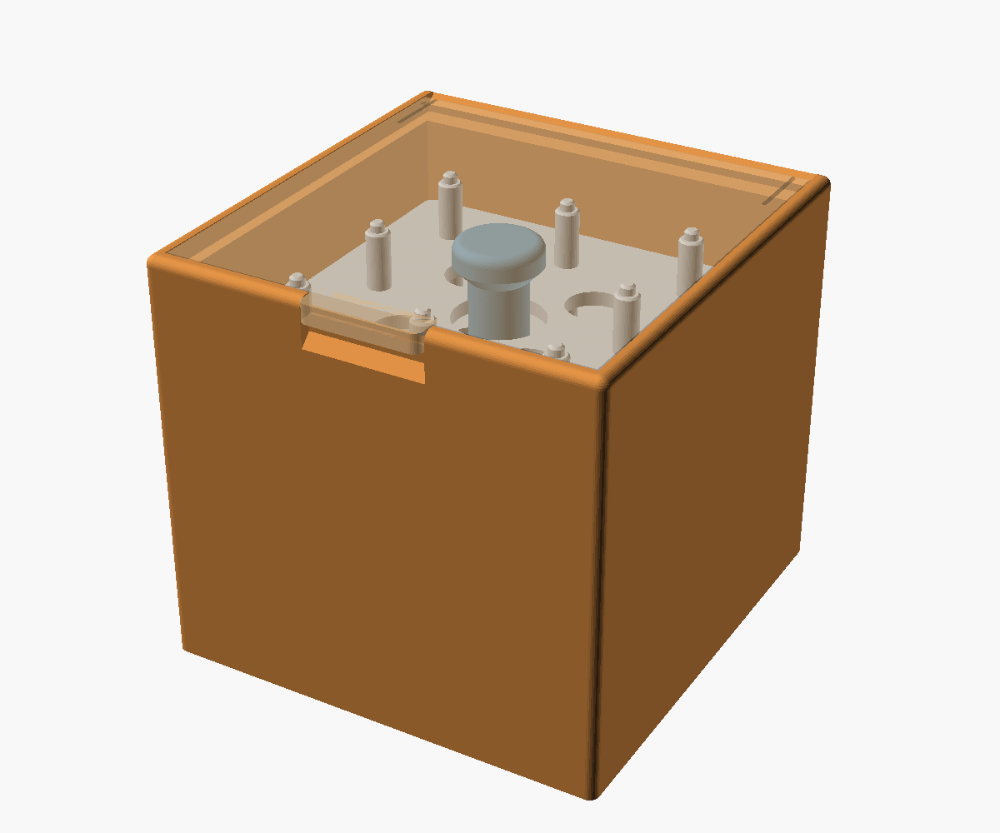
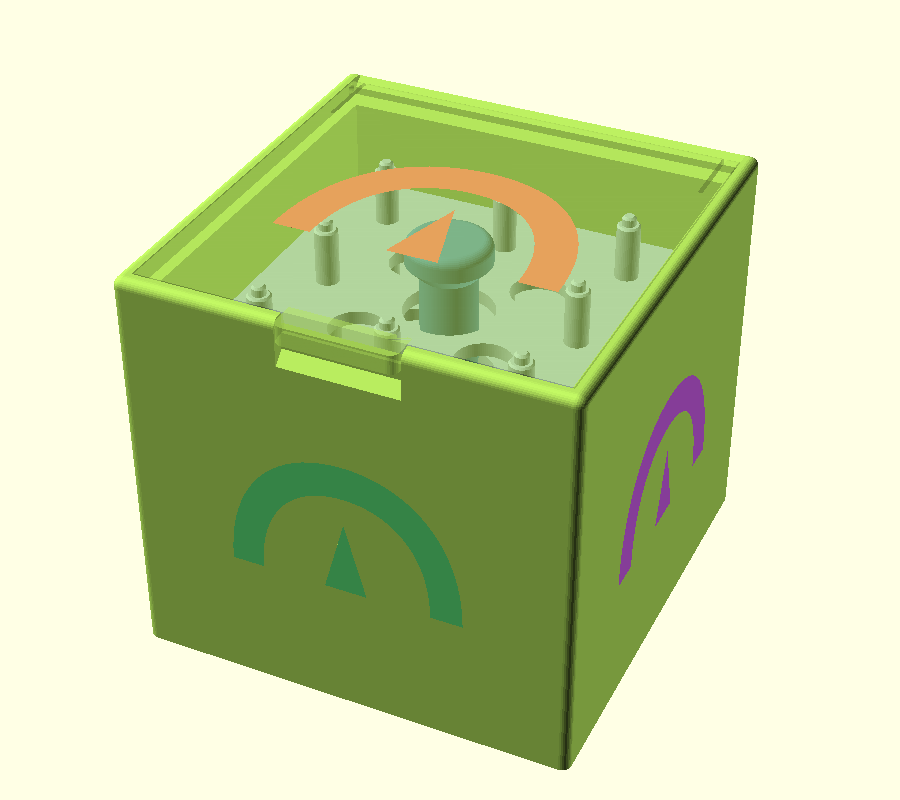

# Bobbin Box

A small lidded box that holds 40 class 15 or class 66 bobbins on five
stacking trays, eight to a tray. A knob on the bottom tray's center column
lifts the whole stack out at once, and every bobbin can be seen from the
side. The lid is hinged on two snap-in dimple hinges and leans back open at
about 135°, or it can be a plain lift-out plate. Any of the six faces can
carry an SVG image: raised, engraved, or inlaid in a second color.

It began as the corner bay and bobbin trays of the
[VSM Base](https://github.com/bobdrzyzgula/VSM-Base), a 3D-printable base
for vintage sewing machines, made into a freestanding box that doesn't need
the base. The same file is kept in that repository too.

## Features

- **Stacking trays**: eight bobbins to a tray on posts, in a 3 × 3 grid
  with the center left for the lifting column. Pins on the post tips fit
  sockets under the tray above, so the stack stays registered when lifted.
- **Lift-out stack**: a knob just under the lid lifts all the trays at
  once.
- **Hinged or lift-out lid**, flush in a rabbet, with a thumb tab and scoop
  on the front instead of a finger hole. The hinged lid snaps onto two
  dimple hinges and rests open at about 135°.
- **Any round bobbin**: set its diameter and thickness, and the trays, box
  and lid size themselves to it and to the number of trays.
- **Images on the faces**: an SVG centered on any of the six faces, raised,
  engraved, or inlaid, with color tags for multi-color printing.
- **Test parts**: one cell of each tray, to try a bobbin on its post, and a
  slice of the hinge, to try the snap before a full print.
- **No supports**: the box prints upright, the lid top face down, the trays
  floor down.

At the default settings (five trays of class 15/66 bobbins) the box is
about 95 × 97 × 88 mm.

## Files

| File | Purpose |
|---|---|
| `bobbin_box.scad` | The parametric model (OpenSCAD with the BOSL2 library) |
| `stl/bobbin_box_box.stl` | The box, hinged, at the default settings |
| `stl/bobbin_box_lid.stl` | The hinged lid |
| `stl/bobbin_box_bottom_tray.stl` | The bottom tray, with the lifting column (print 1) |
| `stl/bobbin_box_upper_tray.stl` | An upper tray (print 4 for the default five trays) |
| `docs/USERS_GUIDE.md` | Settings, printing, images, and use |
| `images/` | OpenSCAD renders |
| `LICENSE` | MIT License |

## Quick start

1. Print the box upright, the lid top face down, and the trays floor down,
   with no supports: one box, one lid, one bottom tray and four upper
   trays.
2. Set the bottom tray in the box and stack the upper trays on it.
3. Snap the lid's hinge bumps into their recesses at the back of the box.
4. Load the bobbins onto the posts.

See the [User's Guide](docs/USERS_GUIDE.md) for other bobbin sizes, the
lift-out lid, the test parts and images on the faces.

## Status

Version 3 (the model's own version numbering, carried over from the VSM
Base).

- **Printed:** the trays are the same design as the VSM Base's, which have
  been printed and used in PETG.
- **Not yet printed:** the freestanding box and lid, and the images on the
  faces.

## Credits and license

Designed and tested by Bob Drzyzgula. The OpenSCAD code, this README and
the User's Guide were written by Claude (Anthropic) at his direction.

Released under the [MIT License](LICENSE).
