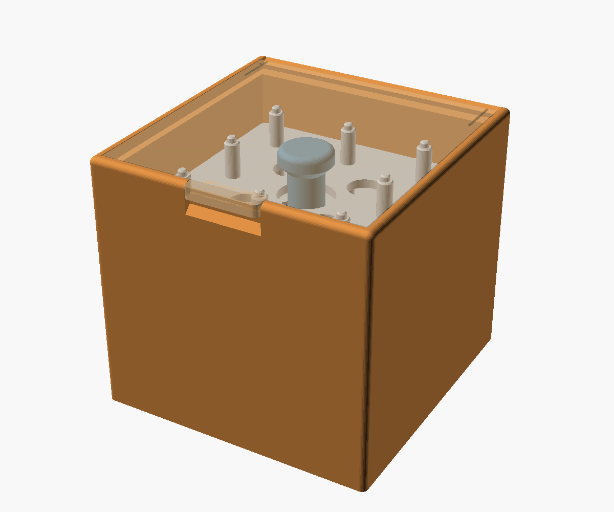

# Bobbin Box — User's Guide

Version 3

The Bobbin Box was designed and tested by Bob Drzyzgula. The OpenSCAD
model and this guide were written by Claude (Anthropic) at his direction.

## Contents

1. [What it is](#1-what-it-is)
2. [How it works](#2-how-it-works)
3. [Parts and printing](#3-parts-and-printing)
4. [Other bobbins and sizes](#4-other-bobbins-and-sizes)
5. [The lid and hinge](#5-the-lid-and-hinge)
6. [Images on the faces](#6-images-on-the-faces)
7. [Settings reference](#7-settings-reference)
8. [Troubleshooting](#8-troubleshooting)
9. [Version history](#9-version-history)
10. [Credits and license](#10-credits-and-license)

## 1. What it is

A small lidded box for sewing-machine bobbins. At the default settings it
holds 40 class 15 or class 66 bobbins (13/16" across, 7/16" thick) on five
stacking trays of eight. The whole stack lifts out by a knob, so you can
see and reach every bobbin from the side.

It started as the corner bay and bobbin trays of the
[VSM Base](https://github.com/bobdrzyzgula/VSM-Base), a 3D-printable base
for vintage sewing machines, and was made into a freestanding box for
anyone who wants the box without the base.

## 2. How it works

- **Trays.** Each tray holds eight bobbins on posts, in a 3 × 3 grid with
  the center left open. Holes where four cells meet lighten the tray.
- **The bottom tray** carries a center column with a knob that reaches up
  to just under the lid. Lifting the knob lifts the whole stack.
- **Upper trays** are all alike. Each has a center hole that clears the
  knob, and rests on the shoulders of the posts below. Pins on the post
  tips fit sockets in the underside of the tray above, so the stack stays
  lined up when it's lifted.
- **The box** is sized to the stack with a little clearance at the walls.
- **The lid** sits flush in a rabbet around the top. A tab on its front
  edge reaches over a notch in the front wall, with a thumb scoop below
  it, so you can catch the lid and lift it without a finger hole.

## 3. Parts and printing

Choose what to render with `part`:

| Part | What it is | How many |
|---|---|---|
| `assembly` | The finished box, for viewing | — |
| `all` | Every part laid out for printing | — |
| `box` | The box | 1 |
| `lid` | The lid | 1 |
| `bottom_tray` | The bottom tray, with the column and knob | 1 |
| `upper_tray` | An upper tray | `trays` − 1 |
| `test` | One cell of each tray: try a bobbin on its post and the pin in its socket | — |
| `hinge_test` | The back of the box and a strip of the lid: try the hinge | — |

The console reports the box's size and how many of each part to print.

- **Orientation:** the box upright, the lid top face down, the trays floor
  down. No supports.
- **Material:** the trays have been printed and used in PETG.
- **Try the test parts first** if you've changed the bobbin size or the
  hinge settings, or if your printer runs tight or loose.
- **Export as 3MF** if any images are raised or inlaid, to keep their
  color tags (see [section 6](#6-images-on-the-faces)).

The `stl/` folder has the box, lid and both trays at the default settings.

## 4. Other bobbins and sizes

The model works for any round bobbin:

- `bobbin_d` and `bobbin_t` are the bobbin's diameter and thickness.
- `post_d` must pass the bobbin's bore. Class 15 and 66 bores are a little
  over 6 mm; the default post is 5 mm.
- `bobbin_gap` is the space between neighboring bobbins, for fingers.
- `trays` sets how many trays, bottom included.

The trays, box and lid all size themselves from these. The console reports
the tray size, the layer pitch and the box size.

## 5. The lid and hinge

`lid_type` chooses a hinged lid or a plain lift-out plate.

The hinged lid pivots on two snap-in dimple hinges at the back: a bump on
each end of the lid, on a flexible tab, snaps into a recess in each end
wall. The back ledge is widened so the open lid stays clear of the
opening, and the back rabbet wall is chamfered so the open lid leans back
and rests at about 135°.

If the hinge is too stiff or too loose, print `hinge_test` and adjust:

- **Snap force:** a longer (`flex_len`) or narrower (`flex_w`) flex tab
  makes a softer snap.
- **Firmness:** `bump_engage` sets how far each bump reaches into its
  recess; `recess_extra_d` loosens the recess around the bump.
- **The lean-back stop:** `open_stop` turns it on or off, and
  `open_stop_extra` adds clearance.

The lid's fit in its rabbet is `lid_clear` per side. The thumb tab's size
and the scoop below it are in the Thumb tab settings.

## 6. Images on the faces

Any of the six faces can carry an SVG image, centered on it: the front,
back and two ends, the bottom, and the lid's top.

- **Choosing the images.** Set `img_front`, `img_back`, `img_left`,
  `img_right`, `img_bottom` and `img_lid` to an SVG's path, relative to
  `bobbin_box.scad`; leave a face `""` for none. Each image is stretched to
  its `…_size`, width and height, so set that to the image's own
  proportions. Every image reads correctly seen from outside its face. The
  bottom's reads with the box tipped over backward, its front edge at the
  top.
- **Raised, engraved or inlaid.** `img_relief` sets all of them: `raised`
  stands `img_depth` (0.6 mm) proud of the face, `engraved` cuts it in, and
  `inlaid` cuts it in and fills the recess flush with a separate part.
- **Colors.** Raised and inlaid images are color-tagged for a second
  filament. The body (box and lid) gets one random color, and each image
  its own, spaced evenly round the color wheel; `color_seed` picks another
  set, and the console lists them. The colors only tell the parts apart;
  you choose the actual filament for each in the slicer.
- **Export as 3MF, not STL,** to keep the color tags: Bambu Studio and Orca
  open it as a multi-color part and ask which filament each color gets.
  STL merges everything into one color, and an inlaid image disappears
  into a plain face. Color-tagged 3MF export needs a recent OpenSCAD with
  the Manifold backend; OpenSCAD 2021.01 doesn't write the tags.
- **Where a second color is practical.** The lid and the bottom print face
  down, so an inlaid image there is in the first few layers, and only
  those layers change filament. The four sides print standing, so an image
  on any of them runs up through dozens of layers, each with a filament
  change. On a single-nozzle printer that means a purge for every change, a
  great deal of waste and hours added. Engraved images on the sides, or
  images in the body's color, avoid it.
- **Raised images** on the bottom or the lid land on the print bed, and on
  the bottom they stop the box sitting flat, so use engraved or inlaid
  there; the console says so.
- **SVGs** must be clean outlines: text converted to paths, overlapping
  shapes merged, no path crossing itself, and no invisible frames or
  unfilled rectangles. OpenSCAD ignores fill and stroke, so an invisible
  shape imports as a solid block.
- **Fit.** The console warns when an image is larger than its face (inside
  the round-overs), when the front image reaches the thumb scoop, when the
  lid's runs into the hinge's flex slots, and when `img_depth` cuts too
  deep into the floor, lid or walls.

## 7. Settings reference

All dimensions are in millimeters.

### Size

| Setting | Default | Meaning |
|---|---|---|
| `trays` | 5 | Number of trays, bottom included (8 bobbins each) |
| `lid_type` | hinged | `hinged` or `lift-out` |

### Bobbin

| Setting | Default | Meaning |
|---|---|---|
| `bobbin_d` | 20.6375 | Bobbin diameter (class 15 and 66: 13/16") |
| `bobbin_t` | 11.1125 | Bobbin thickness (class 15 and 66: 7/16") |
| `post_d` | 5 | Post diameter; must pass the bobbin's bore |
| `bobbin_gap` | 6.9 | Space between neighboring bobbins |

### Walls and lid fit

| Setting | Default | Meaning |
|---|---|---|
| `wall` | 5.5 | Side wall thickness (the back is thicker on the hinged box) |
| `lid_t` | 4 | Lid thickness |
| `lid_clear` | 0.3 | Lid clearance in its rabbet, per side |
| `ledge` | 2.5 | Ledge the lid rests on, inside the lip |

### Hinge

| Setting | Default | Meaning |
|---|---|---|
| `bump_d` | 3 | Bump diameter at its base |
| `bump_engage` | 0.8 | How far each bump reaches into its recess |
| `recess_extra_d` | 0.3 | Recess diameter beyond the bump's |
| `recess_extra_depth` | 0.6 | Recess depth beyond the bump's reach |
| `flex_len` | 15 | Flex tab length (longer: softer snap) |
| `flex_w` | 2.5 | Flex tab width (narrower: softer snap) |
| `flex_slot` | 1 | Slot freeing each flex tab |
| `open_stop` | true | Chamfer so the open lid rests at about 135° |
| `open_stop_extra` | 0.3 | Extra clearance in that chamfer |
| `hinge_margin` | 0.5 | Open lid's clearance past the back ledge |
| `hinge_test_depth` | 25 | Hinge test: depth of the slice, from the back |
| `hinge_test_height` | 10 | Hinge test: height of the box slice below the lid |

### Thumb tab

| Setting | Default | Meaning |
|---|---|---|
| `tab_w` | 25 | Tab width |
| `tab_over` | 1.5 | Tab overhang past the front face |
| `tab_r` | 2 | Tab corner radius |
| `scoop_d` | 2.5 | Thumb scoop depth into the front face |
| `scoop_h` | 6 | Thumb scoop height below the lid |

### Images on the faces

| Setting | Default | Meaning |
|---|---|---|
| `img_front`, `img_back`, `img_left`, `img_right`, `img_bottom`, `img_lid` | `""` | SVG for each face, relative to the model; `""` for none |
| `img_…_size` | [50, 30] | Each image's width and height |
| `img_relief` | raised | `raised`, `engraved` or `inlaid` |
| `img_depth` | 0.6 | Height or depth of the relief |
| `color_seed` | 7 | Picks another set of random color tags |

## 8. Troubleshooting

| Problem | Try |
|---|---|
| A bobbin won't go onto its post | Lower `post_d`; print the `test` part to check |
| The trays don't stack or lift together | Print `test` to check the pins in their sockets |
| The hinge won't snap in, or pops out | Print `hinge_test`; adjust `flex_len`, `flex_w`, `bump_engage` and `recess_extra_d` |
| The lid is tight or rattles in its rabbet | Adjust `lid_clear` |
| An inlaid image comes out the body's color | Export 3MF, not STL, from a recent OpenSCAD |
| An image shows up as a solid block | Clean up the SVG: no invisible frames or unfilled rectangles |
| OpenSCAD can't find `BOSL2/std.scad` | Install [BOSL2](https://github.com/BelfrySCAD/BOSL2) in your OpenSCAD libraries folder |

## 9. Version history

| Version | Changes |
|---|---|
| 1 | Spun off from the VSM Base as a freestanding box |
| 2 | Hinge, lid-fit and thumb-tab settings exposed; `hinge_test` part |
| 3 | SVG images on any of the six faces: raised, engraved or inlaid, color-tagged for multi-color 3MF export |

Added to Sewing Notions in November 2026, at version 3. The same file is
kept in the VSM Base repository.

## 10. Credits and license

Designed and tested by Bob Drzyzgula. The OpenSCAD model and this guide
were written by Claude (Anthropic) at his direction.

Released under the [MIT License](../LICENSE).

The model uses the [BOSL2](https://github.com/BelfrySCAD/BOSL2) library,
which is distributed under its own license and is not included here.
