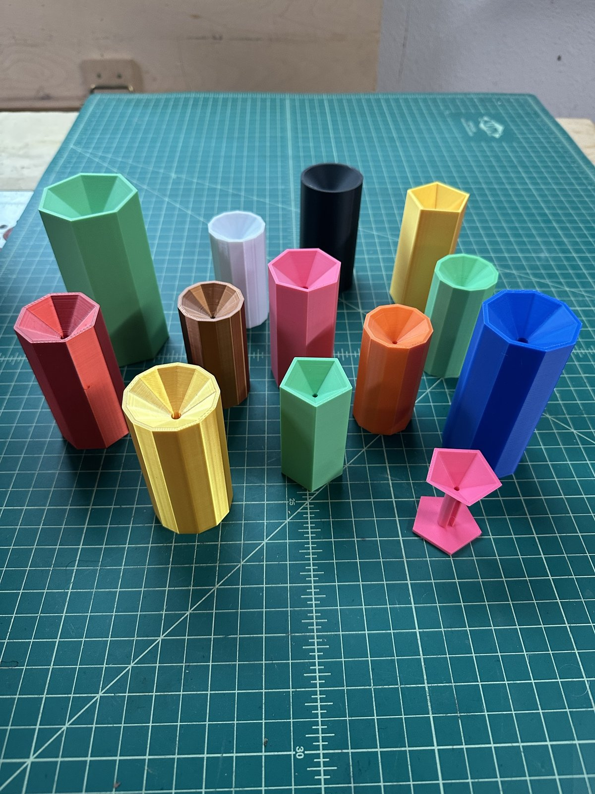
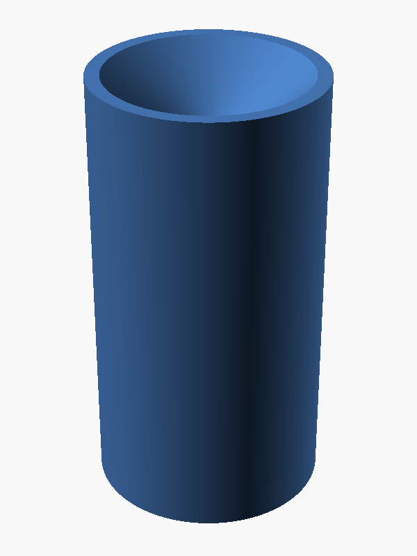
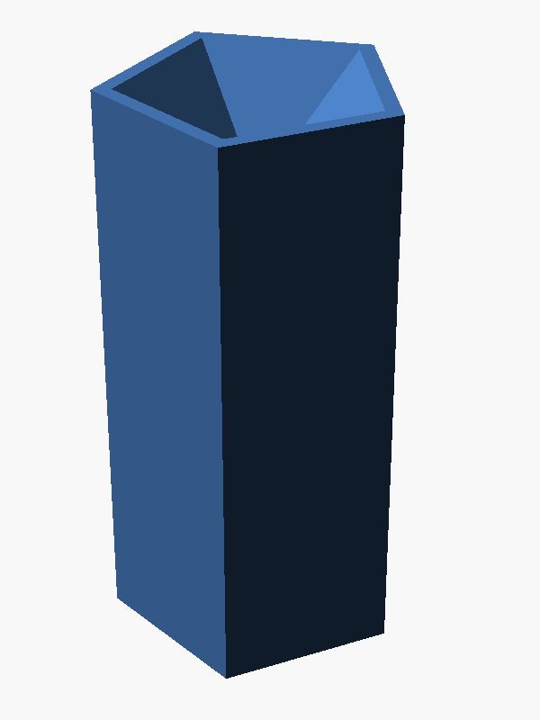
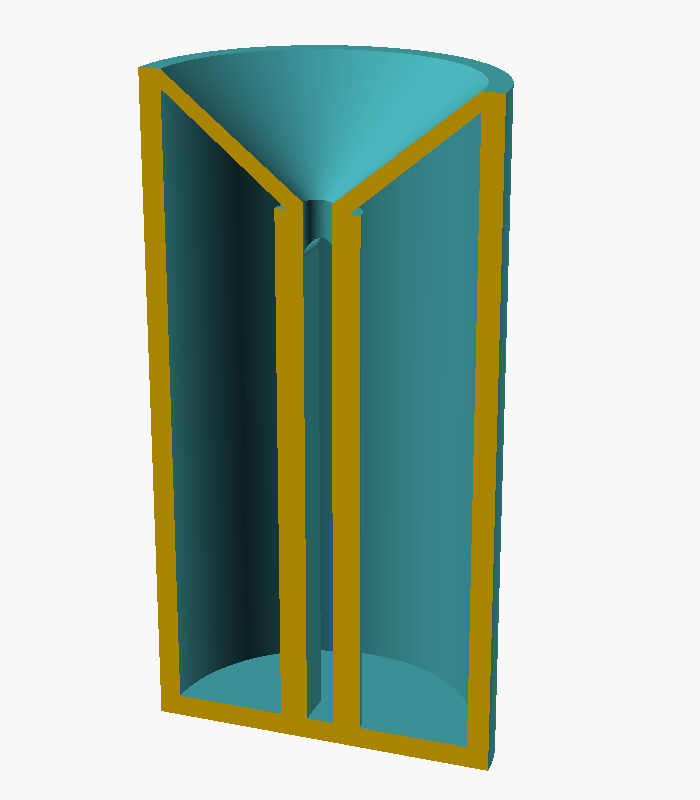
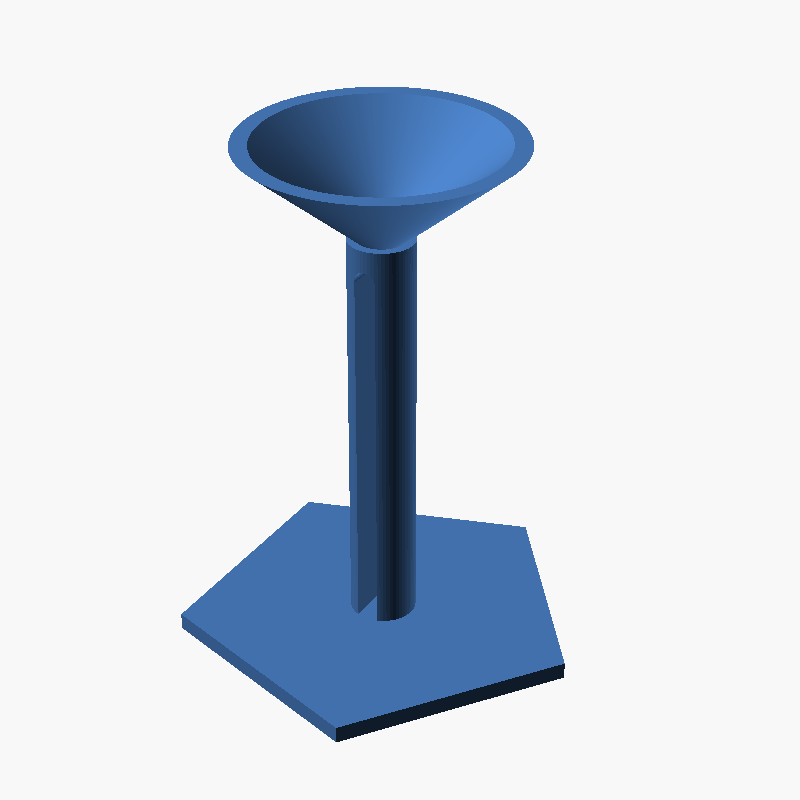

# Needle Bin I

A disposal bin for used and broken sewing needles. Drop a needle into the
funnel on top and it falls through a small hole, down a slot in a post
inside the bin, and tips over into the closed chamber around the post.
Getting back out would mean standing up in the slot and finding the hole
again, so needles don't come out by accident. When the bin is full, throw
the whole thing away.

It prints in one piece, upright, with no supports and no assembly. The bin
is sealed: there is no lid and no way to open it short of a saw.

This is the original, human-written design. [Needle Bin II](../needle-bin-ii/)
is the same bin with recessed logos or text on the side.

| Round (default) | Five faces | Cutaway | Demonstration model |
|---|---|---|---|
|  |  |  |  |

## Features

- **Funnel top** that leads any needle to a 3.2 mm hole, big enough for
  common machine and hand-sewing needles.
- **Split center post**: the hole opens into a slot through the post, open
  on both sides, so a needle falls over into the chamber around it.
- **Sealed, one-piece print**: no lid, no supports, no hardware.
- **Any number of sides**: round by default, or set the shell to 5, 6, 8
  or any number of flat faces. The funnel follows the same shape.
- **Sized for your needles**: set the longest needle it must take, the
  diameter, the wall thickness and the funnel angle; the height follows.
- **Demonstration model**: switch the shell off and a pedestal on to
  show how it works.

At the default settings the bin is 40 mm across and 76 mm tall, with room
for about 60 ml of needles.

## Files

| File | Purpose |
|---|---|
| `needle_bin_i.scad` | The parametric model (plain OpenSCAD, no libraries) |
| `stl/needle_bin_i.stl` | Ready-to-print STL at the default settings (round, 40 mm across) |
| `docs/USERS_GUIDE.md` | How it works, settings, printing, use and disposal |
| `images/` | Photos of printed bins and OpenSCAD renders |
| `LICENSE` | MIT License |

## Quick start

1. Print `stl/needle_bin_i.stl` upright, as it comes, with no supports.
   PLA works well.
2. Drop used needles into the funnel, point first or eye first.
3. When it's full, tape over the hole and dispose of it according to your
   local rules for sharps.

See the [User's Guide](docs/USERS_GUIDE.md) for the settings and for
printing a faceted bin or the demonstration model.

## Status

Version 0.9. Printed many times by Bob Drzyzgula in several sizes and in
shapes from five-sided to fully round (pictured above, along with a
demonstration model on its pedestal).

## Credits and license

Designed, written, printed and tested by Bob Drzyzgula. The README and
User's Guide were written by Claude (Anthropic) at his direction.

Released under the [MIT License](LICENSE).
