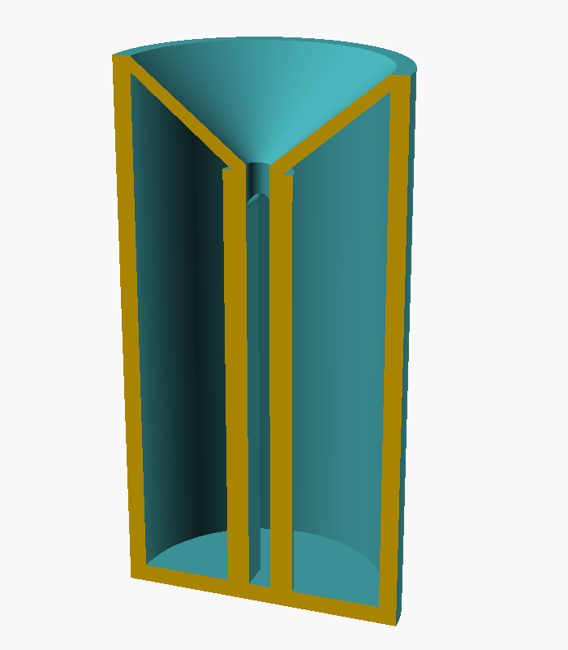
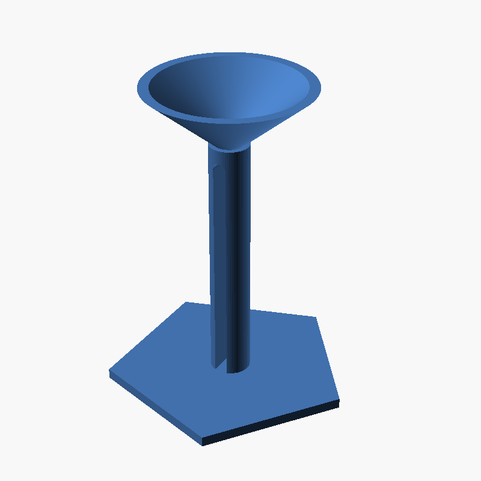

# Needle Bin I — User's Guide

Version 0.9

Model designed and written by Bob Drzyzgula. This guide was written by
Claude (Anthropic) at his direction.

## 1. What it is

Needle Bin I is a small sealed container for used, bent and broken sewing
needles (and pins). You drop needles in through a funnel on top, and they
stay in. When the bin is full you throw the whole thing away, needles and
all, instead of wrapping loose needles in tape or hunting for a pill
bottle.

It prints in one piece, upright, with no supports. There is no lid: the
inside is closed off except for one small hole at the bottom of the
funnel.

It's meant for sewing needles and pins. It isn't a medical sharps
container and shouldn't be used for lancets, syringes or other medical
sharps, which have their own disposal rules.

## 2. How it works

The bin has four parts, all printed as one piece:

- **Shell**: the outer wall and floor. Round by default, or any number of
  flat faces.
- **Funnel**: the top of the bin, a cone sloping down to a 3.2 mm hole at
  its center.
- **Post**: a column standing up the middle of the bin from the floor to
  the bottom of the funnel, which it supports.
- **Slot**: the post is split down most of its height by a slot as wide as
  the hole (3.2 mm) and open on both sides, leaving two pillars. A round
  cross-bore runs across the top of the slot.

A needle dropped into the funnel slides to the hole, falls through the
solid top of the post, and lands in the slot. The slot is open on both
sides, so the needle falls over through one side into the chamber around
the post and lies on the floor with the others.

To get back out, a needle would have to climb back into the slot, stand
upright in it, and line up with the 3.2 mm hole. Shaking or tipping the
bin won't make that happen in practice. It isn't strictly impossible to
shake a needle out, but it's very unlikely to happen by accident.

## 3. Sizes at the default settings

| Dimension | Default |
|---|---|
| Diameter | 40 mm (`outer_radius` = 20) |
| Height | 76.1 mm |
| Wall and floor thickness | 2.5 mm |
| Hole | 3.2 mm diameter |
| Longest needle | 55 mm |
| Post | 9.6 mm diameter |
| Slot | 3.2 mm wide, about 55 mm tall |
| Funnel slope | 40° from horizontal |
| Space for needles | about 60 ml |

The height isn't set directly. It follows from the other settings:

  height = `max_needle_length` + tan(`funnel_angle`) × (`outer_radius` −
  `hole_radius`) + 2 × `hole_radius` + `wall_thickness`

so a longer needle length, a wider bin or a steeper funnel all make the bin
taller.

## 4. Settings

Open `needle_bin_i.scad` in OpenSCAD and change the settings in the
Customizer (Window › Customizer), or edit the values at the top of the
file. All sizes are in millimeters.

### Size and shape

| Setting | Default | What it does |
|---|---|---|
| `hole_radius` | 1.6 | Radius of the hole at the bottom of the funnel; also the slot's width (2 × radius) and the post's size (radius × 3). 1.6 (a 3.2 mm hole) takes common machine and hand needles. |
| `max_needle_length` | 55 | The longest needle the bin must take. Sets the slot's height and, through it, the bin's height. |
| `outer_radius` | 20 | The bin's outside radius. On a faceted bin this is measured to the corners. 12.7 makes a bin one inch across. |
| `shell_facets` | 300 | Number of sides of the shell and funnel. 300 looks round; 5, 6, 8 and so on give flat faces. |
| `round_facets` | 60 | Smoothness of the small round features: the hole, post and cross-bore. |
| `wall_thickness` | 2.5 | Thickness of the shell wall, the floor and the funnel. |
| `funnel_angle` | 40 | Slope of the funnel, in degrees from horizontal. Must be greater than 0 and less than 90. Steeper funnels print more easily and make the bin taller. |
| `overlap` | 0.5 | How far parts overlap so they merge into one solid. Leave it alone. |

### Parts switches

These turn parts of the model on and off. Set a switch to 1 for on and 0
for off. They're for looking inside the model and for the demonstration
model; print the bin with the first three on.

| Setting | Default | What it does |
|---|---|---|
| `generate_shell` | 1 | The outer wall and floor. |
| `generate_post` | 1 | The split center post. |
| `generate_funnel` | 1 | The funnel top. |
| `generate_pedistal` | 0 | A flat stand under the model, for the demonstration model. |
| `pedistal_sides` | 5 | Number of sides of the stand. |
| `pedistal_radius` | 1.5 × `outer_radius` | Size of the stand, to its corners. |
| `pedistal_thickness` | `wall_thickness` | Thickness of the stand. Make it at least `wall_thickness`. A thicker stand covers the bottom of the post; the post and funnel aren't raised to make up for it. |

## 5. Choosing a size

**Needle length.** Set `max_needle_length` to the longest needle you will
put in the bin. A needle longer than the slot can't fall over inside the
post and may jam there, blocking the hole. Household machine needles
(such as 15x1/HAx1) are about 38 mm long, and most hand-sewing needles are
shorter than the 55 mm default. Long needles such as some darners, doll
needles and upholstery needles may be longer, so measure yours.

**Hole size.** 3.2 mm passes the blades of common machine needles and most
hand needles. A smaller hole is harder to shake a needle out of, but makes
needles harder to get in. Thick needles, such as heavy upholstery or
leather needles, may need a larger hole.

**Diameter.** A wider bin holds more and stands more steadily, but is
taller at the same funnel angle.

**Shape.** `shell_facets` changes the look without changing how the bin
works. Five to eight faces give a bin that won't roll off a table and is
easy to grip; 300 looks round. The funnel takes the same shape. With few
faces, the bin is smaller than `outer_radius` suggests, because
`outer_radius` is measured to the corners: on a five-sided bin with
`outer_radius` = 20 the corners are 20 mm from the center but the middle of
each face is only about 16.2 mm from it, and each face is 23.5 mm wide.

## 6. Printing

- **Orientation**: print it as the model comes, upright, floor on the bed.
- **Supports**: none. The post holds up the bottom of the funnel, and the
  funnel's underside slopes at `funnel_angle` from horizontal (40° by
  default). If your slicer asks for supports under the funnel, raise
  `funnel_angle` rather than add supports, because supports inside the
  sealed bin can never be removed.
- **Material**: PLA works well. PETG is tougher if the bin will be knocked
  around.
- **Infill**: walls this thin print essentially solid, so the infill setting
  makes little difference.
- **Stringing**: some filaments string between the two pillars of the post
  across the slot. A few strings won't stop needles, but a heavy web could
  catch them in the slot. If you suspect this, print a demonstration model
  (below) so you can see the post, and tune your retraction or
  temperature.
- **Seams**: with a faceted shell, many slicers can tuck the seam into a
  corner (in Bambu Studio and Orca Slicer, seam position "Aligned" or
  "Back").

The STL in `stl/` is the default round bin, ready to print.

## 7. Using the bin

Drop needles into the funnel, either end first. They slide down to the
hole and fall through; you may hear them land. Pins go in the same way.

The bin is full when needles start to stay in the hole or the funnel
instead of falling through. Don't push them through with a tool: the
chamber is full.

## 8. Disposal

When the bin is full, put a piece of tape over the funnel hole and throw
the bin away whole. Don't try to open it to empty it. Rules for disposing
of sharps vary from place to place, so check your local rules; a sealed,
rigid container like this is the kind of thing they usually ask for.

## 9. Demonstration model

To show people how the bin works, or to check a print's post for
stringing, make a version without the shell, standing on a stand:

- `generate_shell` = 0
- `generate_pedistal` = 1

This prints the funnel and post on a five-sided stand, with the slot in
full view. Drop a needle into the funnel and watch it fall out of the slot.

## 10. Looking inside the model

To see the inside in OpenSCAD, set `generate_shell` to 0 and press F5. The
funnel and post are left standing, as in the demonstration model. Set it
back to 1 before you export for printing.

## 11. Credits and license

Designed, written, printed and tested by Bob Drzyzgula. This guide was
written by Claude (Anthropic) at his direction.

Released under the MIT License; see `LICENSE`.
