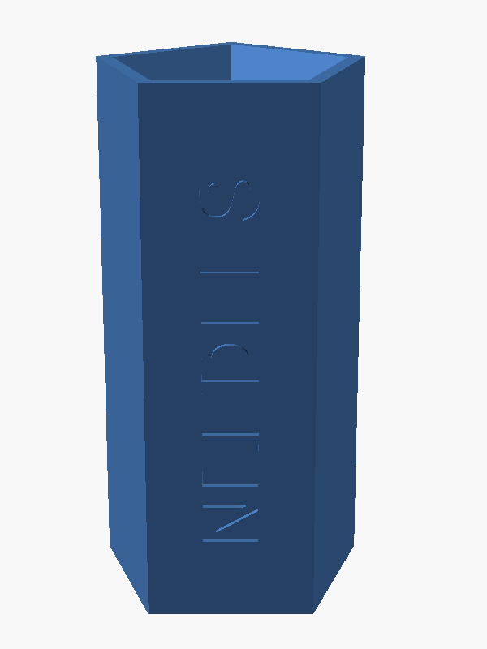
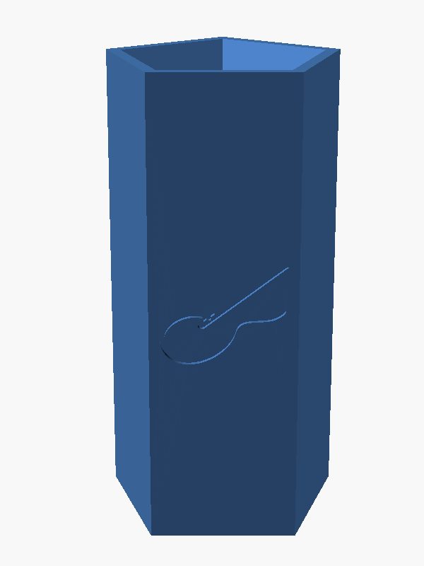
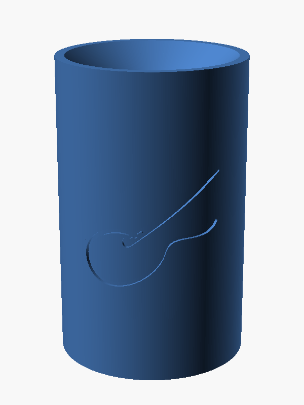
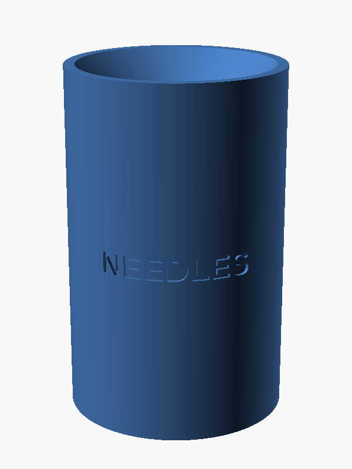

# Needle Bin II

[Needle Bin I](../needle-bin-i/), the sealed disposal bin for used sewing
needles, with recessed artwork on its sides. Bring up to two SVG files (a
shop's logo, a name, or any text you lay out as an SVG) and the model cuts
them into the outside of the bin.

On a bin with a few flat faces, each piece of artwork lies flat on a face.
On a round bin it is wrapped around the curve, so the recess is the same
depth all the way across. Size it as a percentage of the face, or in
millimeters, and it is centered on the side of the bin.

| Five faces: text up the front… | …and a drawing on the back | Round: wrapped drawing… | …and wrapped text |
|---|---|---|---|
|  |  |  |  |

The bin itself works exactly as Needle Bin I does: needles drop through a
funnel and a split post into a closed chamber and don't come back out.
With no artwork the model is the same solid as Needle Bin I.

## Features

Everything in Needle Bin I, plus:

- **Two artwork slots**, each with its own SVG file, size, position,
  rotation and depth. By default one is on the front and one on the back.
- **Flat or wrapped automatically**: up to 8 faces, artwork lies flat on
  the face nearest the angle you ask for; above that, it's wrapped around
  the wall.
- **Sizing by percentage** of the face's width or height, as seen on the
  bin, or in millimeters.
- **Centered vertically** on the side by default, or set at any height.
- **Any rotation**, so text can run up or down a tall, narrow face.
- **Console report** of each face's size, and warnings when artwork would
  run off the bin.
- **Example artwork** and two Customizer presets that use it.

## Files

| File | Purpose |
|---|---|
| `needle_bin_ii.scad` | The parametric model (plain OpenSCAD, no libraries) |
| `needle_bin_ii.json` | Customizer presets: the two examples pictured above |
| `examples/needles_text.svg` | Example artwork: the word NEEDLES |
| `examples/needle_and_thread.svg` | Example artwork: an original needle-and-thread drawing |
| `stl/needle_bin_ii_example_pentagon.stl` | Ready-to-print STL of the five-sided example |
| `docs/USERS_GUIDE.md` | Preparing artwork, placing and sizing it, printing, all settings |
| `images/` | OpenSCAD renders |
| `LICENSE` | MIT License |

## Quick start

1. Open `needle_bin_ii.scad` in OpenSCAD and open the Customizer
   (Window › Customizer).
2. Pick a preset, such as "Example: pentagon, flat artwork", from the menu
   at the top of the Customizer, and render (F6).
3. To use your own artwork, put your SVG file in the same folder as the
   `.scad` file and enter its name in `logo1_file` (and `logo2_file` for a
   second one). The SVG must be filled shapes; see the
   [User's Guide](docs/USERS_GUIDE.md#3-preparing-artwork).
4. Export an STL or 3MF and print it upright with no supports, as for
   Needle Bin I.

## Status

Version 0.11.

- **Printed:** wrapped artwork, on round bins with a recessed shop logo, in
  matte PLA, basic PLA and silk PLA. Matte PLA reads best.
- **Checked in OpenSCAD only:** flat-face placement and the percentage
  sizing and centering added in 0.11. The recesses were measured in the
  exported STLs, but this version has not been confirmed in a print yet.
- **Tested with:** OpenSCAD 2021.01.

## Credits and license

Designed, printed and tested by Bob Drzyzgula, from his Needle Bin I. The
artwork features (SVG placement, flat and wrapped recesses, sizing and
centering) were written by Claude (Anthropic) at his direction, as were
the README, the User's Guide and the example artwork.

Released under the [MIT License](LICENSE).
