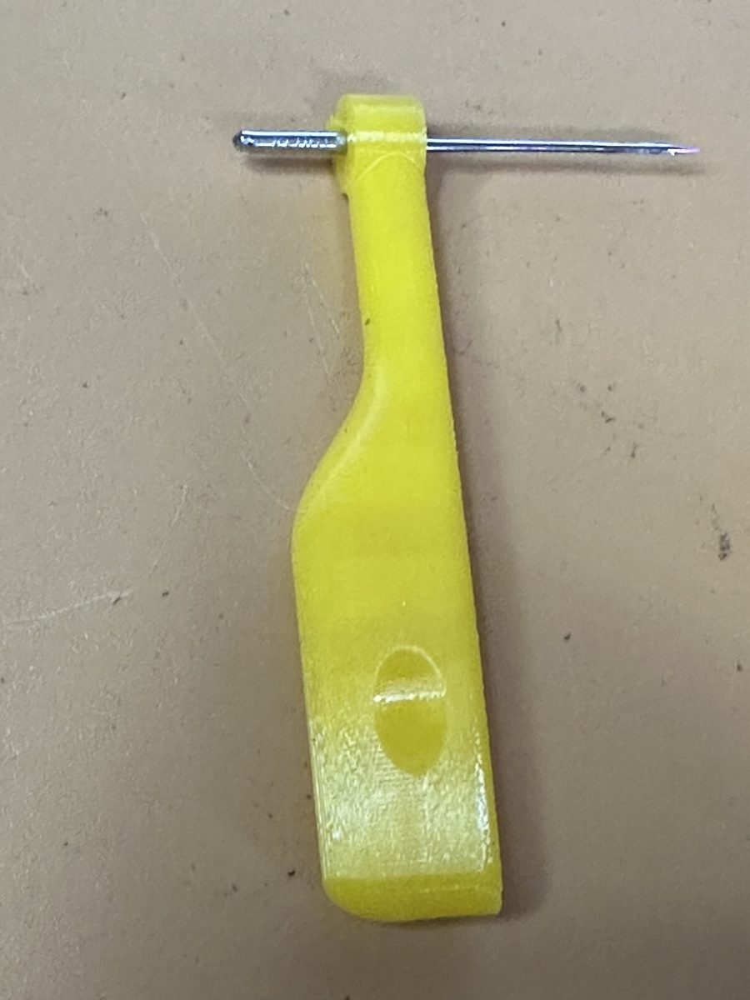
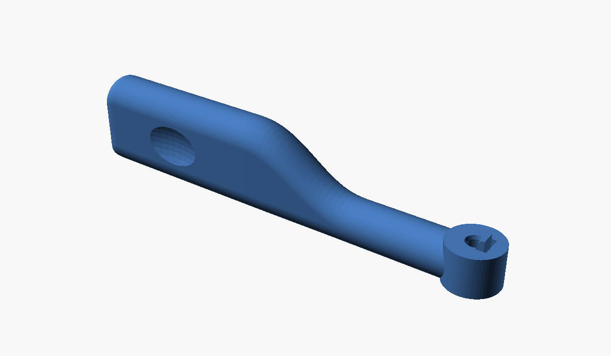
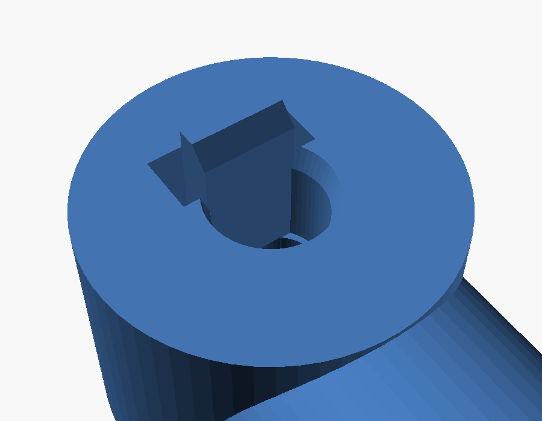
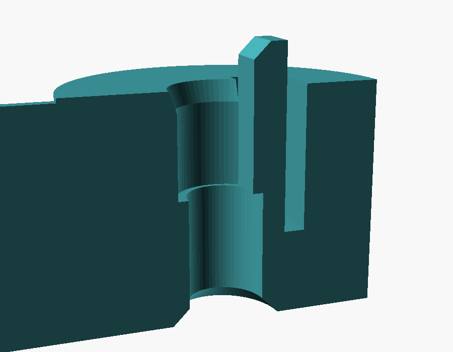

# Needle Inserter

A small tool for putting a needle into a household sewing machine. It holds
an HAx1 (15x1, 130/705 H) needle by its shank, with the flat of the shank
facing the right way, so you can raise it straight up into the needle clamp
and tighten the clamp without the needle dropping or turning.

The idea comes from the needle-holder end of a common plastic needle
threader. This version leaves out the threader and puts the holder on a
broad, upright grip that you pinch between thumb and forefinger, so the
needle stays vertical without twisting your wrist.

| The whole tool | The head | Cutaway through the head |
|---|---|---|
|  |  |  |

## Features

- **Keyed pocket**: the shank sits in a D-shaped pocket whose flat wall
  matches the flat on the needle's shank, so the needle goes into the clamp
  facing the right way.
- **Spring tab**: the flat wall is a thin tab, free on three sides, that
  presses the needle's flat against it. Thin-flatted and thick-flatted
  needles are both held snug, and the tab stands 1 mm above the head to
  catch a flat that stops short of the pocket.
- **Shoulder stop**: the blade passes down through a hole in the bottom of
  the pocket, and the shoulder of the needle rests on it.
- **Oval neck hole**: the hole is a little longer in the direction the blade
  swells around the eye, so large needles pass without binding.
- **Upright grip**: a flat paddle, 13 mm tall, with a finger dimple on each
  face, blending smoothly into a slim shaft out to the head.
- **Prints flat-bottomed and upright**: no supports, and both needle holes
  print vertically, where they come out round and accurate.

At the default settings the tool is 62 mm long, 7.5 mm wide at the head and
12.4 mm tall.

## Files

| File | Purpose |
|---|---|
| `needle_inserter.scad` | The parametric model (OpenSCAD with the BOSL2 library) |
| `stl/needle_inserter.stl` | Ready-to-print STL at the default settings |
| `docs/USERS_GUIDE.md` | How it works, settings, printing, use and fitting |
| `images/` | Photos of the printed tool and the needles, and OpenSCAD renders |
| `LICENSE` | MIT License |

## Quick start

1. Print `stl/needle_inserter.stl` as it comes, flat side down, with no
   supports. PETG works well.
2. Drop a needle point-first into the head, with the flat of its shank
   against the tab.
3. Raise the needle bar to its highest point, then lift the needle up into
   the clamp until it stops. Tighten the clamp.
4. Draw the tool straight down off the needle.

See the [User's Guide](docs/USERS_GUIDE.md) for the settings and for
fitting the holes to your printer and needles.

## Status

Version 1.0. Printed in basic PETG and tested by Bob Drzyzgula with #9,
#14 (Flying Tiger) and #21 (Organ) needles: all three pass the neck hole,
seat on the shoulder, and are held by the tab without spinning.

## Credits and license

Designed, printed and tested by Bob Drzyzgula. The OpenSCAD model, this
README and the User's Guide were written by Claude (Anthropic) at his
direction.

Released under the [MIT License](LICENSE).
