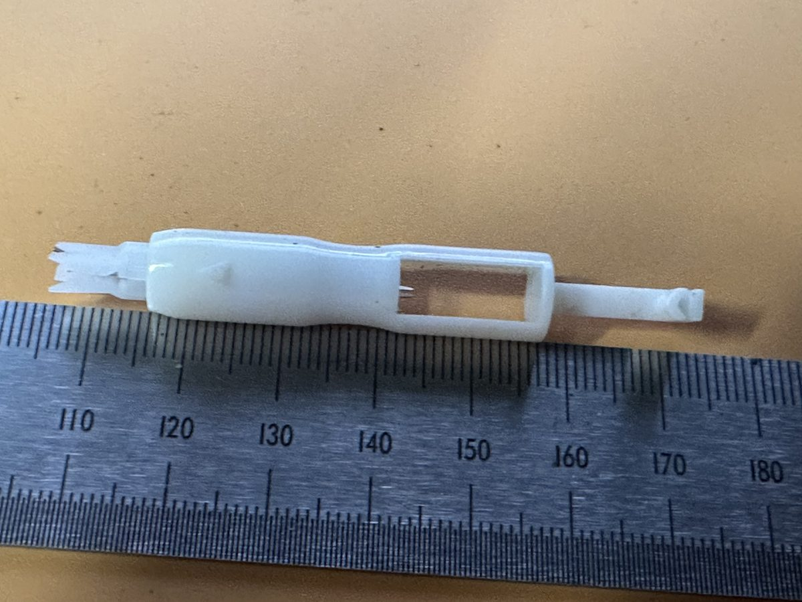
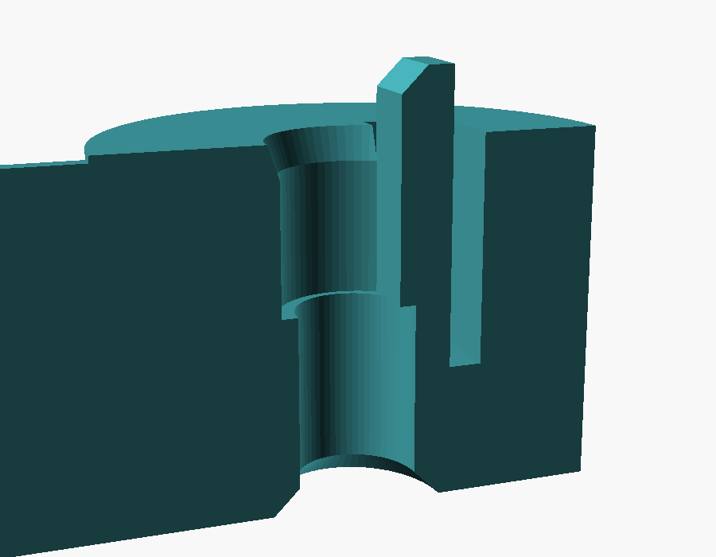
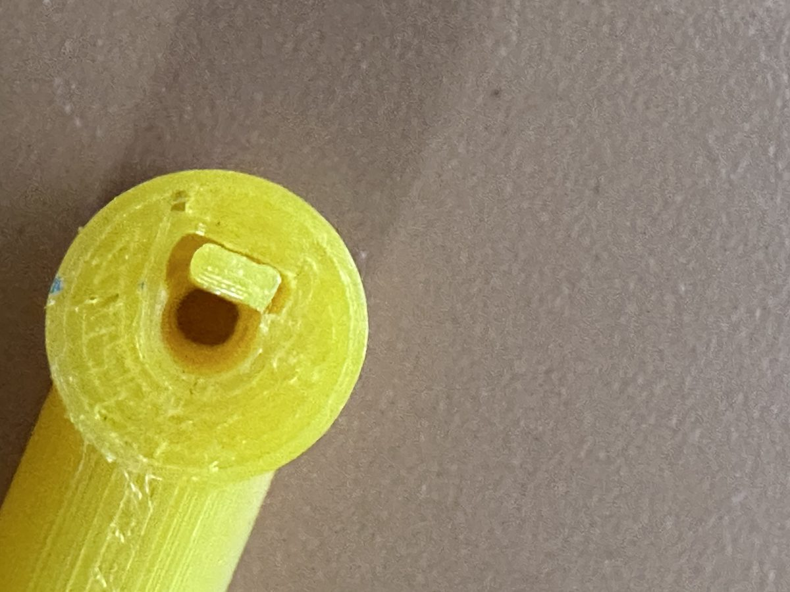
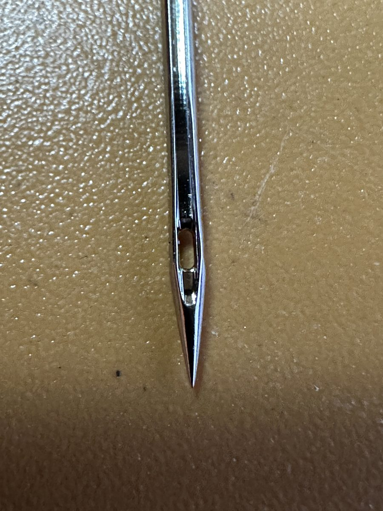

# Needle Inserter — User's Guide

Version 1.0

The Needle Inserter was designed, printed and tested by Bob Drzyzgula. The
OpenSCAD model and this guide were written by Claude (Anthropic) at his
direction.

## Contents

1. [What it is](#1-what-it-is)
2. [How it works](#2-how-it-works)
3. [The needle it fits](#3-the-needle-it-fits)
4. [Using it](#4-using-it)
5. [Printing](#5-printing)
6. [Fitting the holes to your printer and needles](#6-fitting-the-holes-to-your-printer-and-needles)
7. [Settings reference](#7-settings-reference)
8. [Troubleshooting](#8-troubleshooting)
9. [Version history](#9-version-history)
10. [Credits and license](#10-credits-and-license)

## 1. What it is

Changing the needle on a household sewing machine means holding a small,
slippery needle up inside the needle clamp, with its flat facing the right
way, while you tighten a screw. The Needle Inserter holds the needle for
you. The needle sits in a pocket at the end of a slim shaft, kept upright
and turned the right way, and you hold the tool by a flat grip.

It takes the HAx1 needle system (also sold as 15x1 and 130/705 H) used by
nearly all household machines.

The idea comes from the needle-holder end of a common plastic needle
threader, pictured below. The other end of that threader, the wire that
pulls thread through the eye, is left out here.

## 2. How it works

The working end is a round collar, the **head**, with the needle's axis
running vertically through it. From the top down it has:

- **The pocket**, shaped like a D to match the needle's shank: round on
  one side, flat on the other. Its mouth is chamfered on the round side
  only, so the flat runs straight up to the top.
- **The spring tab**, which forms the flat side of the pocket. It's a thin
  wall attached only at its bottom, with a slot on both sides and behind
  it, so it can flex. At rest its face stands a little inside the pocket,
  so it presses the needle's flat and holds the shank against the round
  side. It also stands 1 mm above the top of the head, to reach a needle
  whose flat stops short of the pocket.
- **The shoulder seat**, at the bottom of the pocket, where the neck hole
  begins. The needle's shoulder, the taper between the shank and the
  blade, rests here.
- **The neck hole**, which the blade passes through and out the bottom of
  the head. It is slightly oval: the blade of a large needle swells a
  little around the eye (see [section 6](#6-fitting-the-holes-to-your-printer-and-needles)),
  and the long axis of the oval clears that swelling.

The **shaft** runs out sideways from the head and blends smoothly into the
**grip**, a flat paddle standing on edge. Held between thumb and
forefinger, the paddle keeps the needle vertical with your hand in a
natural position. A shallow dimple on each face of the grip shows where
your fingers go.

The whole tool shares one flat bottom, so it prints lying the way it's
used, with no supports, and the pocket and neck hole print as vertical
holes.

## 3. The needle it fits

The model's needle settings come from published figures where there are
any:

| Dimension | Value | Source |
|---|---|---|
| Shank diameter | 2.04 mm | Needle makers and distributors (e.g. Groz-Beckert, Organ); ISMACS's cross-reference chart gives 2.02 measured |
| Blade diameter | Size ÷ 100: NM 70 is 0.70 mm, NM 130 (#21) is 1.30 mm | Schmetz |
| Largest blade | 1.40 mm (NM 140, #22) | Organ sells HAx1 up to this size |
| Shank across the flat | 1.75 mm (estimate) | **Not published**, and varies from brand to brand; measure your needles with calipers |

Needle makers don't publish the across-the-flat dimension of the shank or
how far the flat runs down toward the shoulder, and both vary by brand.
That is why the flat wall is a spring tab rather than a fixed wall: one
size of fixed wall is snug on some needles and loose on others.

## 4. Using it

1. **Load the needle.** Hold the tool by the grip with the head away from
   you. Drop the needle in point-first, with the flat of the shank facing
   the tab, and push it down until the shoulder seats. The tab gives a
   little as the shank goes past it.
2. **Get the machine ready.** Turn the handwheel to raise the needle bar to
   its highest point, raise the presser foot, and loosen the clamp screw.
3. **Insert the needle.** Bring the tool in under the clamp with the
   needle upright and its flat facing the way your machine wants it (the
   back on most modern machines; check your manual). Push it straight up
   until the needle stops against the top of the clamp.
4. **Tighten the clamp.**
5. **Remove the tool.** Draw it straight down: the blade slides back out
   through the neck hole.

The pocket's flat faces away from the grip, toward the far end of the tool.
If you approach the needle from the front of the machine, that puts the
flat toward the back. For a machine whose flat faces to the side, such as
a Singer 15 or 99, either turn the tool as you approach or print a copy
with `flat_angle` set to −90 (flat to the right) or 90 (flat to the left).

## 5. Printing

- **Orientation:** as it comes from the model, flat side down. No supports.
- **Material:** PETG is recommended; the spring tab needs some give, and
  PETG bends without cracking. The tested copies were printed in basic
  PETG.
- **Walls:** the tab is 0.8 mm thick, two lines with a 0.4 mm nozzle. Make
  sure your slicer prints it as solid walls; if it drops the tab or turns
  it into a single wavy line, check the wall settings or adjust `tab_t`.
- **The slot around the tab** is 0.5 mm wide. Check after printing that
  it's open all the way down. If your slicer bridges it shut, raise
  `tab_gap`.
- **First layer:** the neck hole opens onto the build plate, where a
  squashed first layer narrows it. The model chamfers the bottom of the
  hole (`neck_chamfer`) to allow for this; your slicer's elephant-foot
  compensation helps too.

## 6. Fitting the holes to your printer and needles

Printed holes come out smaller than drawn, by an amount that depends on
the printer, the filament and the slicer. All hole sizes in the model are
as drawn, with clearances you can adjust.

**The neck hole** has two jobs: it must pass the largest blade you use,
and it must stop the shoulder. The blade of a large needle is slightly
wider around the eye than above it, by roughly 0.10 to 0.15 mm on the #21
above. A round hole small enough to stop the shoulder bound on that
swelling, so the hole is oval:

- `neck_d` (1.80 mm) is the short axis, which stops the shoulder.
- `neck_oval` (0.25 mm) is added to give the long axis, 2.05 mm, which lies
  parallel to the flat, the direction the blade swells.

If a large needle binds on its way through, increase `neck_oval` first,
then `neck_d`. If the needle drops too far, so its shoulder doesn't seat,
decrease `neck_d`.

**The pocket** is the shank diameter plus `pocket_clr`, and its flat is
the across-the-flat dimension plus `af_clr`. With the spring tab on, the
pocket can be a little loose; the tab takes up the difference.

**The spring tab** grips harder with more `tab_preload`, and is stiffer
with a thicker tab (`tab_t`) or a shorter one (smaller
`tab_root_below_seat`). A PETG tab can also be bent inward by hand if a
needle still turns.

## 7. Settings reference

All dimensions are in millimeters. The model refuses to render, with a
message in the console, if the neck hole would let the shoulder through or
block the largest blade, if the flat would be wider than the pocket, or if
the slot around the tab would leave less than 0.8 mm of wall.

### Needle

| Setting | Default | Meaning |
|---|---|---|
| `shank_d` | 2.04 | Shank diameter |
| `shank_af` | 1.75 | Shank across the flat (measure your needles) |
| `blade_max` | 1.40 | Largest blade the neck hole must pass |

### Holes (as drawn)

| Setting | Default | Meaning |
|---|---|---|
| `pocket_clr` | 0.25 | Added to `shank_d` for the pocket |
| `af_clr` | 0.20 | Added to `shank_af` for the pocket's flat |
| `neck_d` | 1.80 | Neck hole, short axis |
| `neck_oval` | 0.25 | Extra length of the neck hole's long axis, parallel to the flat |
| `pocket_depth` | 2.5 | Depth of the pocket above the shoulder seat |
| `neck_len` | 3.0 | Length of the neck hole below the seat |
| `neck_chamfer` | 0.4 | Chamfer at the bottom of the neck hole |
| `pocket_chamfer` | 0.5 | Lead-in chamfer at the pocket mouth (round side only) |
| `flat_angle` | 0 | Direction the flat faces: 0 away from the grip, 90 left, −90 right |

### Spring tab

| Setting | Default | Meaning |
|---|---|---|
| `spring_tab` | true | Use the spring tab; false gives a fixed flat wall |
| `tab_t` | 0.8 | Tab thickness |
| `tab_w` | 2.0 | Tab width; keep it wider than the flat on the needle |
| `tab_preload` | 0.15 | How far the tab's face stands into the pocket at rest |
| `tab_gap` | 0.5 | Width of the slot around the tab |
| `tab_root_below_seat` | 1.0 | How far below the shoulder seat the tab is attached |
| `tab_ext` | 1.0 | How far the tab stands above the top of the head |
| `tab_chamfer` | 0.4 | Lead-in chamfer on the tab's top inside edge |

### Head

| Setting | Default | Meaning |
|---|---|---|
| `head_wall` | 2.6 | Wall around the pocket (keep to 3 or less, for room around the clamp) |
| `head_front_ext` | 0 | Stretches the head toward the flat side, for more wall behind the tab |

### Shaft and grip

| Setting | Default | Meaning |
|---|---|---|
| `shaft_d` | 6.0 | Shaft diameter |
| `shaft_len` | 15 | Straight shaft, from the needle's axis to the start of the blend |
| `trans_len` | 18 | Length of the blend from shaft to grip |
| `grip_len` | 25 | Grip length |
| `grip_h` | 13 | Grip height (upright, parallel to the needle) |
| `grip_t` | 6.5 | Grip thickness |
| `end_r` | 3.0 | Rounding at the end of the grip |
| `base_cut` | 0.6 | How much is trimmed off the round parts to make the flat bottom |

### Finger dimples

| Setting | Default | Meaning |
|---|---|---|
| `dimples` | true | Dimple each face of the grip |
| `dimple_depth` | 0.7 | Depth of each dimple |
| `dimple_len`, `dimple_h` | 18, 12 | Size of each dimple on the face |

### Rendering

| Setting | Default | Meaning |
|---|---|---|
| `$fn` | 64 | Smoothness of curves |
| `loft_steps` | 24 | Number of steps in the shaft-to-grip blend |

## 8. Troubleshooting

| Problem | Try |
|---|---|
| A large needle binds going through the neck hole | Raise `neck_oval`, then `neck_d`; check the bottom of the hole for first-layer squish |
| The needle drops too far and the shoulder doesn't seat | Lower `neck_d` |
| The needle turns in the pocket | Raise `tab_preload`, or bend the tab in a little by hand |
| The needle is hard to push past the tab | Lower `tab_preload` or `tab_t`, or raise `tab_root_below_seat` for a longer, softer tab |
| The slot around the tab printed shut | Raise `tab_gap` |
| The flat faces the wrong way for your machine | Turn the tool as you approach, or print with a different `flat_angle` |
| The head crowds the presser foot or clamp | Lower `head_wall` |
| OpenSCAD can't find `BOSL2/std.scad` | Install [BOSL2](https://github.com/BelfrySCAD/BOSL2) in your OpenSCAD libraries folder |

## 9. Version history

| Version | Changes |
|---|---|
| 1.0 | First published version: keyed pocket with spring tab, oval neck hole with bottom chamfer, upright grip. Tested in PETG with #9, #14 and #21 needles. |

## 10. Credits and license

Designed, printed and tested by Bob Drzyzgula. The OpenSCAD model and this
guide were written by Claude (Anthropic) at his direction. Needle
dimensions are from published figures by Groz-Beckert, Organ, Schmetz and
ISMACS. The across-the-flat dimension isn't published; the model's value
is an estimate.

Released under the [MIT License](../LICENSE).

The model uses the [BOSL2](https://github.com/BelfrySCAD/BOSL2) library,
which is distributed under its own license (BSD 2-Clause) and is not
included here.
