# Pattern Weights

Pattern weights made from a short stack of ordinary flat steel washers, held
in a printed cup with a screw-on lid and a felt pad underneath. There's also
a tall rounded-square storage box that holds a set of them, with a hinged lid
and a snap latch.

| A weight, cut away | The box, cut away |
|---|---|
| 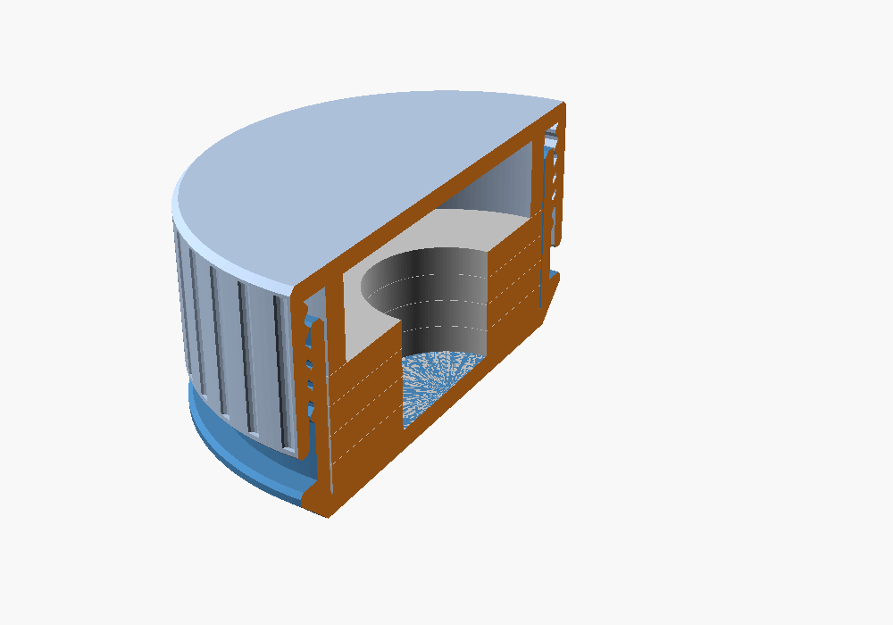 | 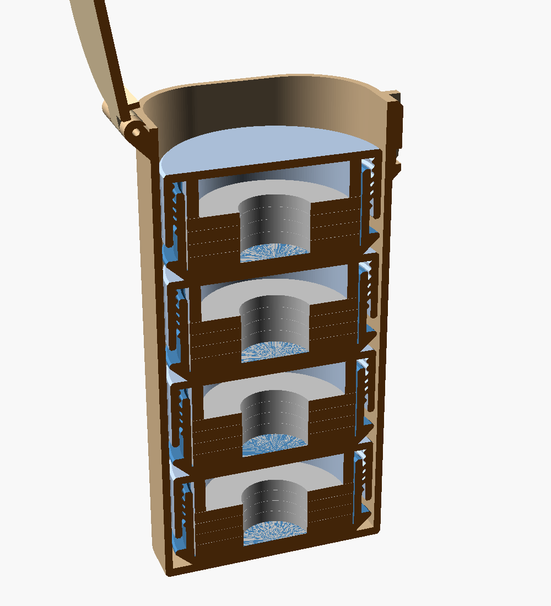 |

This model replaces a set Bob printed from MakerWorld parametric models
early in 2026. It keeps that set's 2-inch washers, 2-inch felt pad and tall
rounded-corner box. It adds full parameterization, a lid that copes with
real-world washer thickness, and a hinged and latched box lid in place of
the old lid, which didn't print well.

## Features

- **Any common washer**: USS, SAE, ISO 7089 and ISO 7093, from ¾ in up to
  4 in outside diameter, any number high, or a custom washer.
- **Felt pad base**: the bottom tapers (chamfer, round or cove) down to the
  largest standard inch or metric felt pad that fits, or a size you choose.
- **A lid that always looks closed**: it screws down onto the top washer,
  so the stack is clamped tight. A plain skirt below the threads covers any
  thread it leaves exposed. Washers anywhere within the standard thickness
  range fit, and a thick stack never looks like a lid that isn't screwed
  down.
- **Walls sized to the load**, two-start 45° threads that print without
  supports and close in about 2½ turns.
- **Artwork** from an SVG file: engraved, inlaid in a second colour, or
  raised on the weight lid, and engraved or inlaid on the box lid and under
  the box.
- **Storage box** sized to the weights, with a filament-pin hinge and a
  snap latch strong enough to hold the full box upside down.
- **Console report** of the dimensions, felt pad, heights and mass of one
  weight and of the set (mild steel washers).

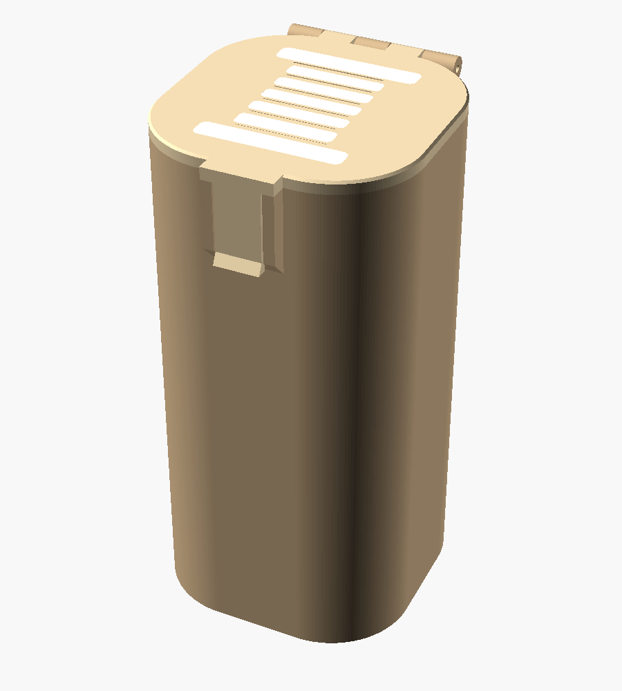

## Files

| File | Purpose |
|---|---|
| `pattern_weights.scad` | The parametric model (OpenSCAD with BOSL2) |
| `examples/` | Example artwork: a thread spool (`spool.svg`), a needle and thread (`nat.svg`), and sewing machines (`Singer.svg`, `singer99k_line_40mm.svg`, `singer99k_silhouette_40mm.svg`) |
| `stl/weight_body_uss_3_4_x4.stl` | Weight body for four USS ¾ washers, at the defaults |
| `stl/weight_lid_uss_3_4_x4.stl` | Its lid, face-down for printing |
| `stl/box_4_weights_uss_3_4.stl` | Storage box for four of those weights |
| `stl/box_lid_4_weights_uss_3_4.stl` | Its lid, face-down for printing |
| `docs/USERS_GUIDE.md` | How it works, settings, printing and assembly |
| `images/` | OpenSCAD renders |
| `LICENSE` | MIT License |

## Quick start

1. Install [BOSL2](https://github.com/BelfrySCAD/BOSL2) in OpenSCAD's
   libraries folder.
2. Open `pattern_weights.scad`, choose your **washer** and
   **washer_count** in the Customizer, and read the report in the console.
3. Set **part** to `weight` and export. Print the body upright and the lid
   face-down, with no supports. Stack the washers in, stick a felt pad on
   the bottom, and screw the lid down snug.
4. Set **part** to `box_set` and export. Push a length of 1.75 mm filament
   through the hinge knuckles and mushroom its ends with a little heat.

The [User's Guide](docs/USERS_GUIDE.md) covers every setting.

## Status

Version 1.5. Printed and working:

- weights: a ½ in USS set in PETG, and a ⅝ in USS set in PLA with a silk
  PLA inlay on the lid;
- one-weight boxes in translucent PETG with opaque PETG inlays on the
  lid. The second, at version 1.4.2 with a 1.8 mm latch tab, holds shut
  when shaken; that tab thickness is now the default.

Every part, washer size and option has been rendered and checked in
OpenSCAD (2021.01 with current BOSL2), and the meshes checked for
exactly-touching solids, which newer Manifold-based builds export as
degenerate triangles.

| Engraved and inlaid lids | Inside: plug ring on the washers | Felt-pad bases |
|---|---|---|
| 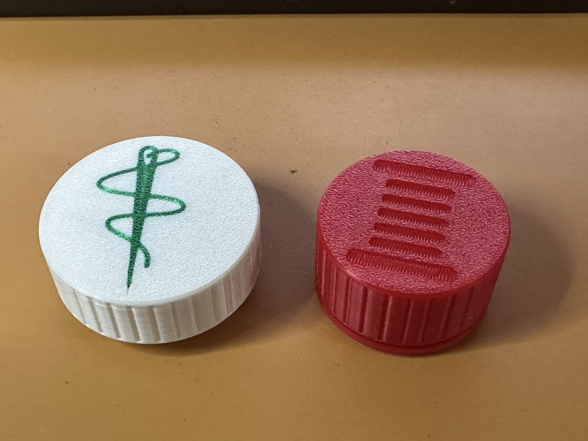 | 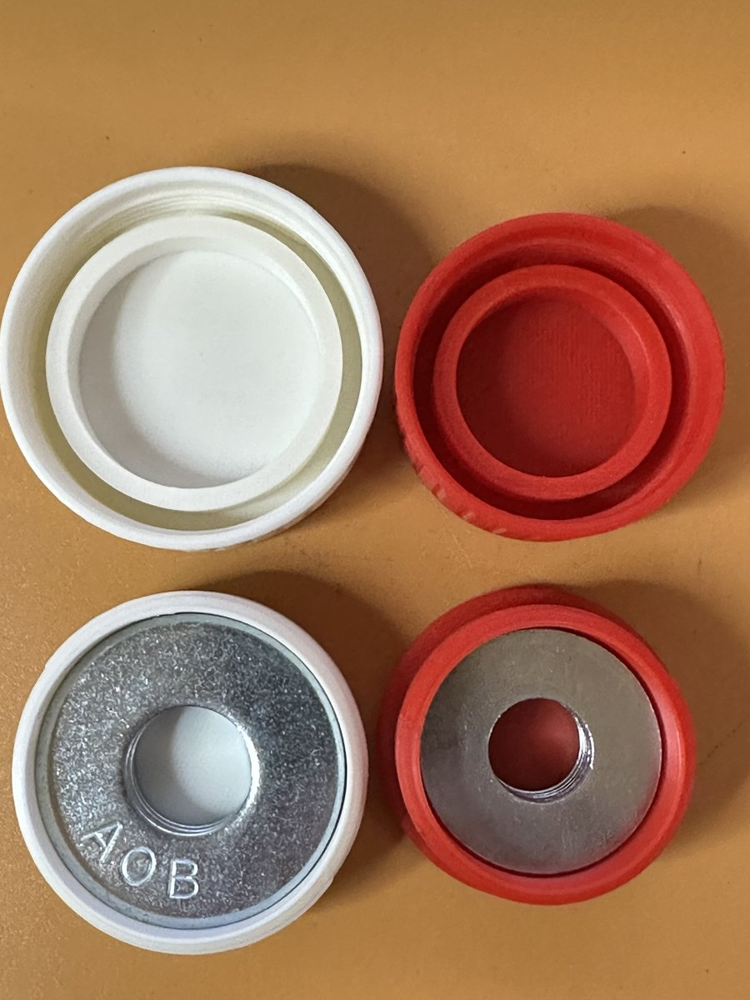 | 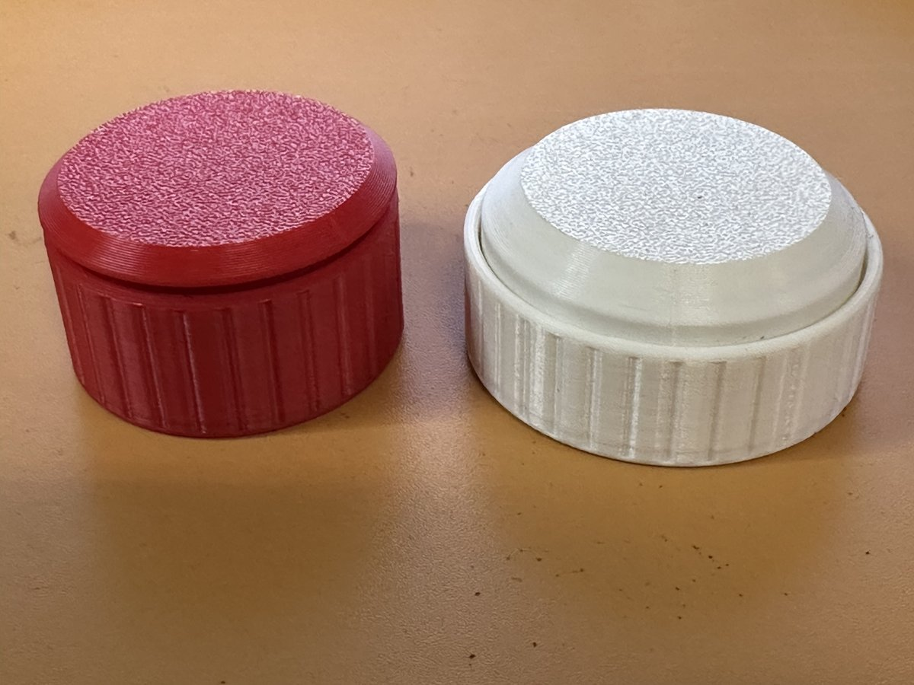 |

| Box with a sewing machine inlay | Inlay detail at 45 mm | Open |
|---|---|---|
| 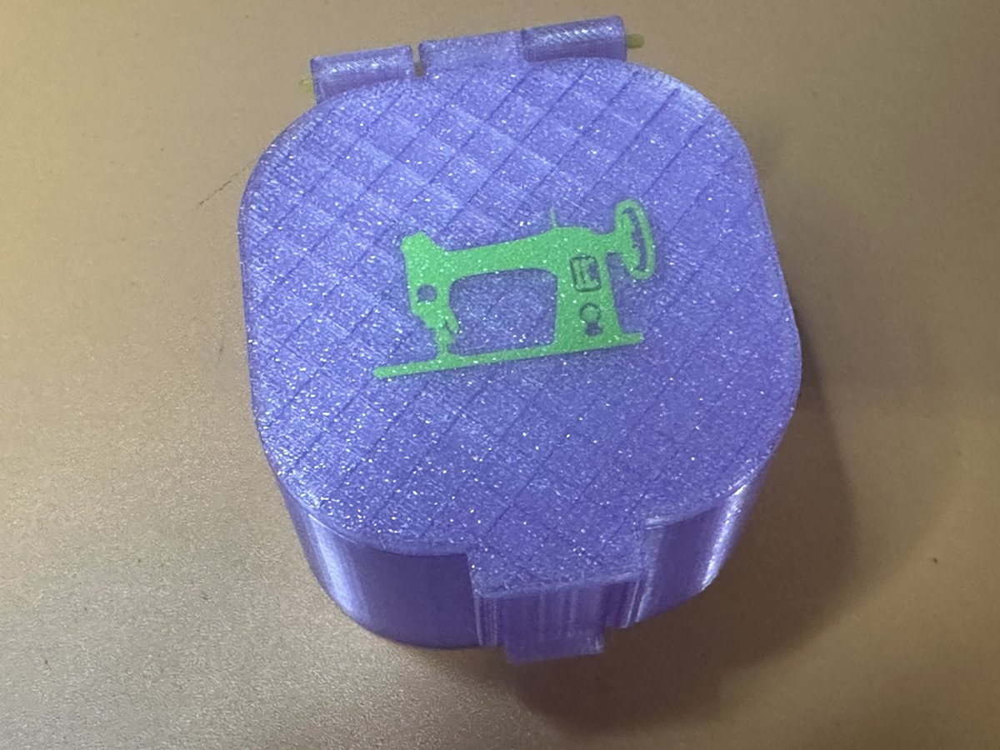 | 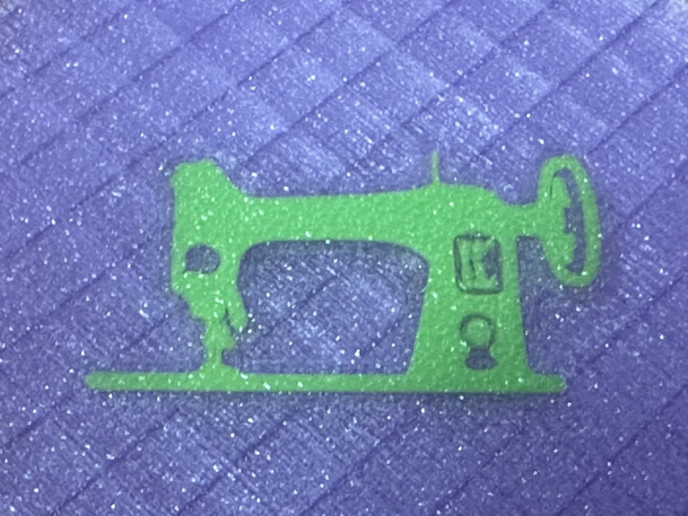 | 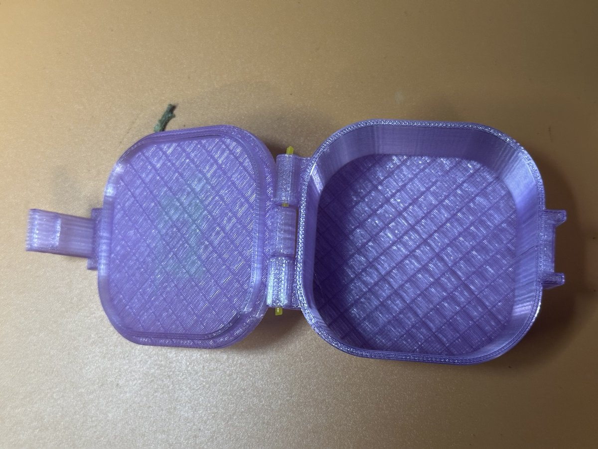 |

| The first box, with a weight | Inlaid box lid | Closed |
|---|---|---|
| 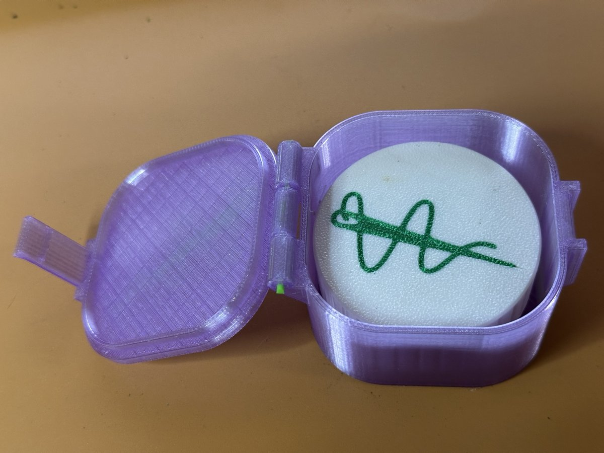 | 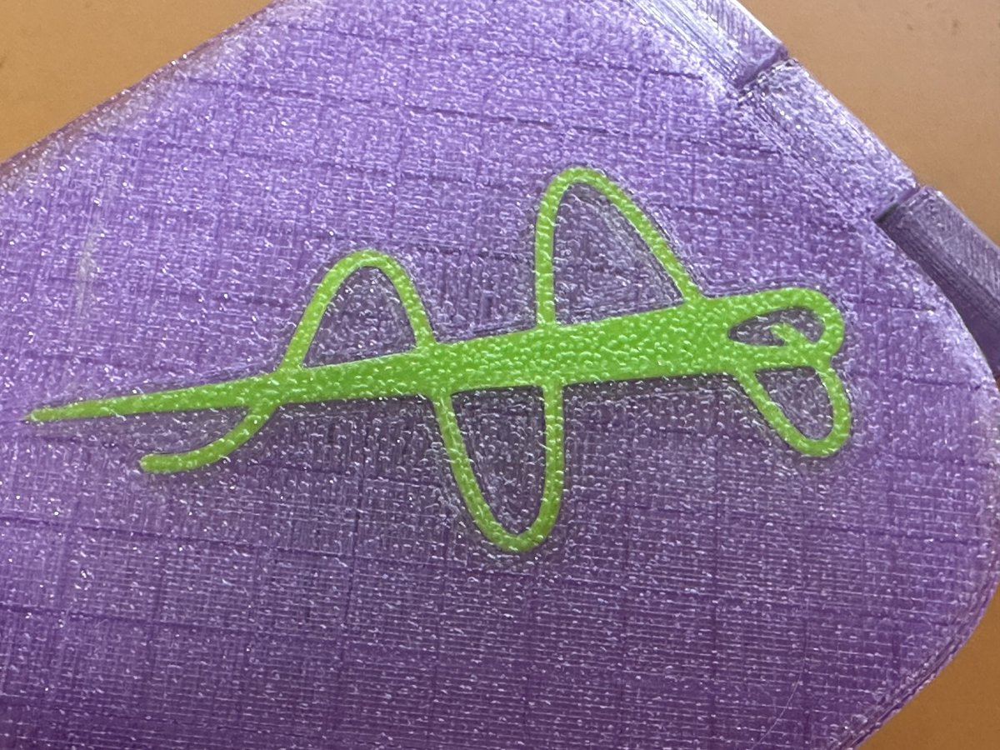 | 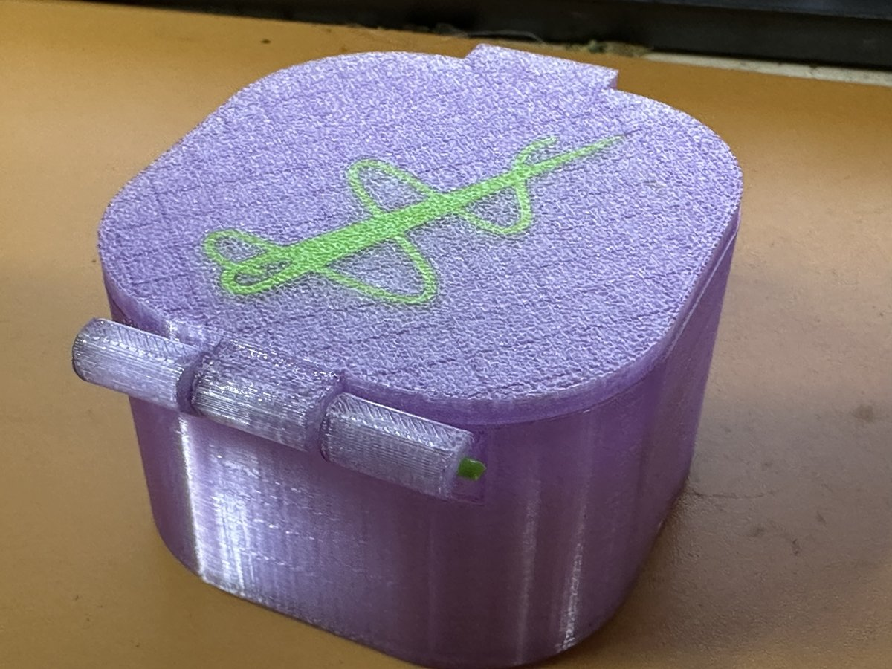 |

## Credits and license

Made at the request of Bob Drzyzgula, who set the requirements from his
earlier set. The design, the OpenSCAD model, this README and the User's
Guide were written by Claude (Anthropic) at his direction.

Released under the [MIT License](LICENSE).
