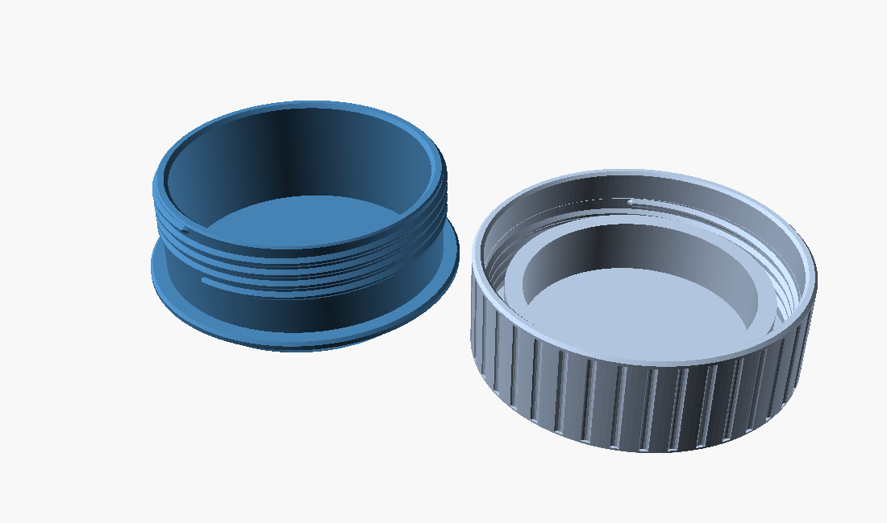
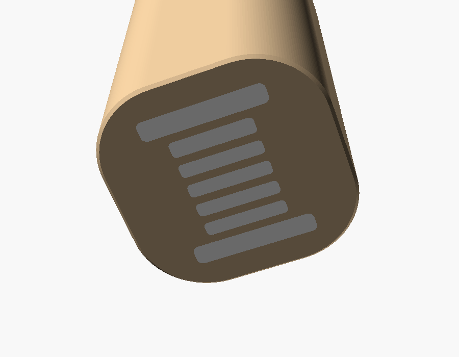
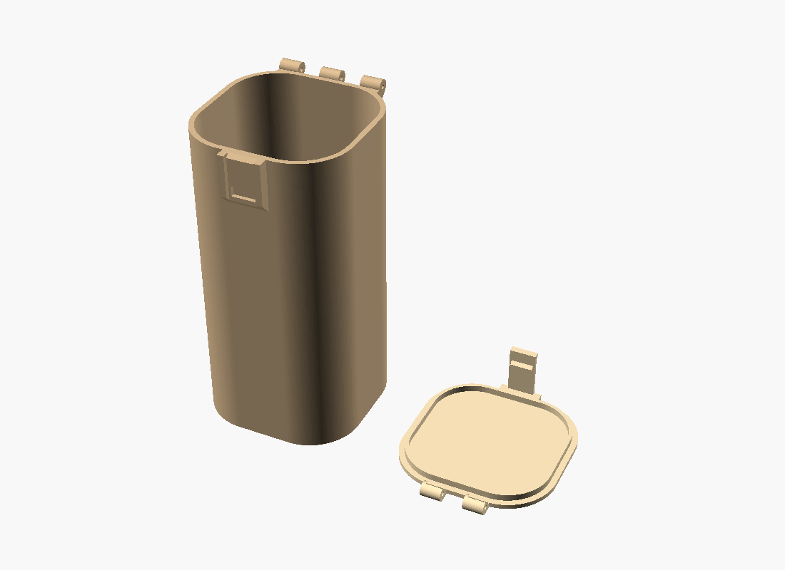

# Pattern Weights — User's Guide

Version 1.3.1

The Pattern Weights were made at the request of Bob Drzyzgula. The design,
the OpenSCAD model and this guide were written by Claude (Anthropic) at his
direction.

## Contents

1. [What it is](#1-what-it-is)
2. [Requirements](#2-requirements)
3. [Washers](#3-washers)
4. [How the lid copes with thickness variation](#4-how-the-lid-copes-with-thickness-variation)
5. [Felt pad and base](#5-felt-pad-and-base)
6. [Walls and threads](#6-walls-and-threads)
7. [Artwork](#7-artwork)
8. [The storage box](#8-the-storage-box)
9. [Parts and printing](#9-parts-and-printing)
10. [The console report](#10-the-console-report)
11. [Settings reference](#11-settings-reference)
12. [Troubleshooting](#12-troubleshooting)
13. [Version history](#13-version-history)
14. [Credits and license](#14-credits-and-license)

## 1. What it is

Pattern weights hold paper patterns and fabric flat while you trace or cut.
Washers make good weights: they're dense, cheap, uniform and sold
everywhere. This model makes a printed cup for a stack of them, with a
screw-on lid that clamps the stack so it doesn't rattle, and a felt pad
underneath so it doesn't scratch the table or slide on fabric. The matching
storage box holds a set, stacked.

## 2. Requirements

- [OpenSCAD](https://openscad.org/) (tested with 2021.01; newer builds
  render much faster).
- [BOSL2](https://github.com/BelfrySCAD/BOSL2) in OpenSCAD's libraries
  folder. It provides the threads.
- Washers, self-adhesive round felt pads, and, for the box, a few
  centimeters of 1.75 mm filament for the hinge pin.

A full render takes about 30 seconds for a weight and 6 seconds for the
box set in OpenSCAD 2021.01.

## 3. Washers

Choose **washer** from the list:

- **USS** (wide) plain washers, ¼ to 1¾ in nominal (0.734 to 4.000 in
  OD).
- **SAE** (narrow) plain washers, ⅜ to 1½ in nominal.
- **ISO 7089** (normal) metric washers, M10 to M42.
- **ISO 7093** (large) metric washers, M8 to M30.
- **custom**: enter `custom_od`, `custom_id`, and the nominal, minimum and
  maximum thickness, all in mm. Use this for fender washers, odd sizes, or
  washers you've measured.

The table's dimensions are typical ASME B18.22.1 and ISO values, including
each washer's allowed thickness range. Real washers vary by maker. Check a
few with calipers, and use **custom** if yours differ.

**washer_count** sets how many go in each weight. **bore_clearance**
(default 0.8 mm on the diameter) is the clearance between the washers and
the cup wall.

## 4. How the lid copes with thickness variation

Washer thickness tolerances are loose. Four USS ¾ washers can stack
anywhere from 12.4 to 18.0 mm and still meet the standard. A lid that
screws down to a fixed stop would either rattle on a thin stack or stop
short on a thick one, leaving a gap.

This lid has no stop. It screws down until its underside presses on the
top washer, so the stack is always clamped tight. When the stack is short,
a ring-shaped plug inside the lid reaches down into the cup to meet it.

Two features keep a thick stack from looking like an unclosed lid:

- **A plain skirt.** Below the lid's threads is a smooth section, long
  enough to cover whatever thread on the body the lid leaves exposed. You
  never see bare thread.
- **The style.** In the **flush** style (the default), the lid's outside
  diameter matches the base, and a smooth reveal groove separates them. The
  groove is at least `min_reveal` wide, and widens by however much thicker
  the stack is. It reads as a design detail, not a gap. In the **overcap**
  style, the lid fits over a plain cylindrical body like a jar cap, so
  there's no edge to compare it with. Overcap weights are a few mm shorter.

**stack_tolerance** sets how much variation the lid must absorb:

- `spec` (default): the full standard minimum-to-maximum thickness for
  every washer. The most generous, and the tallest weight.
- `percent`: ± `tolerance_percent` of the nominal stack height.
- `mm`: explicit `tolerance_under_mm` and `tolerance_over_mm`.

A narrower range makes a shorter weight. With four USS ¾ washers, `spec`
gives a weight 31 mm tall at nominal thickness; `percent` at 12% gives about
26 mm.

## 5. Felt pad and base

**felt_pad** chooses the pad:

- `auto_in` (default): the largest standard inch pad (¾, 1, 1½, 2, 3 or
  4 in) that fits under the body.
- `auto_mm`: the same from a metric list (20 to 100 mm).
- A specific size, `custom` (`custom_pad_d`), or `none`.

The base tapers from the body down to a footprint `pad_margin` wider than
the pad. It's never closer than `min_base_inset` to the body's edge.
**base_profile** sets the taper's shape:

- `chamfer`: a straight 45° chamfer.
- `round`: convex, a 45° start rounding into the side.
- `cove`: concave, straight down at the pad and flaring out at 45°.

All three are limited to 45° so they print without supports.
`base_curve_r` sets the curve radius for `round` and `cove`. The floor
thickens automatically where a taper would otherwise thin the wall around
the washers. `pad_recess` adds an optional shallow pocket to locate the pad.

## 6. Walls and threads

The wall thickness comes from the mass of steel the weight carries: about
2.0 mm for light weights, 2.4 mm for 200 g, rising to 4 mm for the
heaviest. `wall_override` sets it directly.

The threads have 45° flanks, so they print cleanly upright. The pitch scales
with diameter, from 2 to 3.5 mm (`thread_pitch_override` sets it
directly). They're two-start by default (`thread_starts`), so the lid
closes in about half the turns: around 2½ for the default weight. The fit
is set by `thread_slop` (BOSL2's `$slop`, default 0.15 mm). Raise it if the
lid binds, lower it if it's sloppy.

The **lid_flutes** add shallow vertical grip grooves around the lid.

## 7. Artwork

There are three places for artwork from an SVG file. Each has its own file,
size and rotation. Size an image by width; give a height too only if you
want to change its proportions. The default width is 55% of the lid or box.

### On the weight lid

**svg_mode**:

- `engrave`: recessed `svg_depth` into the lid top. The lid prints
  face-down, so the artwork prints on the bed.
- `inlay`: the same recess, filled with a separate solid of the artwork,
  flush with the top, for a second colour.
- `raise`: standing `svg_depth` above the top. The lid then prints upright,
  and its ceiling needs supports. Use `inlay` if you'd rather avoid that.

`svg_mirror` flips the artwork. The report gives the lid's flat top
diameter; keep the artwork inside it.

### On the box lid and under the box

**box_lid_svg_mode** and **box_bottom_svg_mode** each take `engrave` or
`inlay`. Both surfaces print on the bed (the box lid face-down, the box on
its bottom), so raised artwork isn't offered there. The artwork under the
box is mirrored automatically, so it reads correctly when you turn the box
over. **box_svg_depth** sets the depth for both. Each adds that depth to
the plate it's cut into, so the plate stays as strong as before.

### Printing inlays

Every printed part shares one colour and all the artwork shares
another, and each is its own solid. With the **lazy-union** feature
turned on (OpenSCAD Preferences, Features), a 3MF export holds one
object per solid: for `box_set` with an inlaid lid, that's the box, the
lid and the lid's artwork.

- **Bambu Studio** opens it with an *Import Model* dialog. **Simplify
  Colors** should show 2 colours; if it shows more, set the count to 2.
  In **Filament Matching**, pick a filament for the parts and one for
  the artwork. The artwork is exported sitting in the lid's recess, but
  it's a separate object, so the slicer may move it off the lid. If it
  does, put it back: select both and use *Assemble*, and check that it
  lies flush in the recess before slicing.
- **OrcaSlicer** ignores the 3MF's colours. Make sure the artwork sits
  in the lid's recess as above, and set its filament by hand.
- If the parts come in as more than two colours (an older version of
  the model, or your own colour changes), merge them to two. Otherwise
  a plate holding both the box and the lid makes pointless swaps
  between identical filaments.

With OpenSCAD 2021.01, which has no lazy-union, export the part and its
artwork separately as STLs (`lid_only` and `inlay`, `box_only` and
`box_lid_only` with `box_inlays`), then add the artwork to the part in
the slicer as a second part.

## 8. The storage box

The box is a tall rounded square that holds `box_count` weights stacked,
sized for the tallest allowed weight plus `box_headroom`. Its walls come
from the mass of the whole set (`box_wall_override` sets them directly).
`box_corner_fraction` sets how round the corners are.

### The hinge

Interleaved knuckles run along the back, their tops flush with the top of
the lid. The pin is a length of 1.75 mm filament in a 2.0 mm hole
(`hinge_pin_hole`; use 3.2 for an M3 screw or ⅛ in rod). Push it through
and soften each end with a lighter or soldering iron to mushroom it. The
lid opens past vertical.

### The latch

A flexible tab hangs from the front of the lid into a channel in a boss on
the box. Its hook rides down the channel floor and snaps into a pocket with
a square roof. To open, pull the flared tip of the tab outward and lift.

Because the hook and pocket meet square, the latch doesn't cam open under
load: a full box can be held upside down. The hinge, the latch, and the lip
around the underside of the lid share the load. The latch isn't designed
to survive being dropped.

The latch width is automatic (12 mm, narrower on small boxes;
`latch_width_override` sets it). `latch_thickness`, `latch_length` and
`latch_hook` set the tab's stiffness, flex length and hook depth.

## 9. Parts and printing

| part | what it is | print orientation |
|---|---|---|
| `weight` | body and lid side by side | body upright, lid face-down |
| `body`, `lid` | each one separately | as above |
| `lid_only`, `inlay` | the lid and its artwork as separate solids | as above |
| `box_set` | box and lid side by side | box upright, lid face-down |
| `box`, `box_lid` | each one separately | as above |
| `box_only`, `box_lid_only`, `box_inlays` | without the artwork solids, and the artwork alone | as above |
| `weight_cutaway`, `box_cutaway` | previews only | not for printing |

Every part prints without supports, except a weight lid with raised
artwork. Notes:

- **Material**: PETG for the box lid, because the latch tab flexes about
  1 mm every time it closes. That's fine for PETG but hard on PLA over
  time. The weights and the box itself can be PLA or PETG.
- **The latch hook** prints as a 1.4 mm unsupported ledge on the face-down
  lid. It droops a little at most, and that doesn't affect the latch.
- **Layers**: 0.2 mm is fine; finer layers make smoother threads.

### Assembly

1. Stack the washers in the body.
2. Stick a felt pad to the bottom, centered on the footprint.
3. Screw the lid down until it's snug on the washers. Don't force it.
4. For the box, push the hinge pin through the knuckles and mushroom its
   ends.

## 10. The console report

Each render prints a **PATTERN WEIGHT REPORT**. It gives:

- the washer's dimensions and the accepted stack range;
- the wall, floor, lid top and lid plug sizes;
- the thread size and the turns to close;
- the body and lid diameters, the chosen felt pad and footprint;
- the assembled height for the thinnest, nominal and thickest stacks;
- the mass of one washer and the stack (mild steel at `steel_density`,
  7.85 g/cm³), the plastic printed solid (at `plastic_density`: PETG 1.27,
  PLA 1.24), the whole weight, and the whole set;
- the box's outside size and wall.

The plastic estimate assumes solid parts. Your slicer's filament estimate
gives the exact figure.

At the defaults (four USS ¾ washers), each weight is about 252 g (8.9 oz),
and a set of four is about 1.0 kg (2.2 lb), in a box 70 × 70 × 143 mm.

## 11. Settings reference

| Setting | Default | What it does |
|---|---|---|
| `part` | `weight` | What to render (section 9) |
| `washer` | USS ¾ | Washer from the list, or `custom` |
| `washer_count` | 4 | Washers per weight |
| `custom_od`, `custom_id`, `custom_thickness`, `_min`, `_max` | 2 in USS | Custom washer, mm |
| `stack_tolerance` | `spec` | `spec`, `percent` or `mm` (section 4) |
| `tolerance_percent` | 12 | For `percent` |
| `tolerance_under_mm`, `tolerance_over_mm` | 1.5, 2.0 | For `mm` |
| `bore_clearance` | 0.8 | Washer-to-wall clearance on the diameter |
| `felt_pad` | `auto_in` | Pad size (section 5) |
| `custom_pad_d` | 38.1 | For `custom` |
| `pad_margin` | 1.5 | Footprint beyond the pad edge |
| `min_base_inset` | 1.5 | Footprint at least this far in from the wall |
| `base_profile` | `chamfer` | `chamfer`, `round` or `cove` |
| `base_curve_r` | 8 | Curve radius for `round` and `cove` |
| `pad_recess` | 0 | Depth of a pad-locating pocket |
| `weight_style` | `flush` | `flush` or `overcap` |
| `wall_override` | 0 (auto) | Wall thickness |
| `thread_pitch_override` | 0 (auto) | Thread pitch |
| `thread_starts` | 2 | Thread starts |
| `thread_slop` | 0.15 | Thread clearance |
| `min_reveal` | 1.5 | Narrowest reveal groove (flush style) |
| `lid_flutes` | on | Grip grooves on the lid |
| `svg_mode` | `none` | Weight lid artwork: `engrave`, `inlay`, `raise` |
| `svg_file` | `examples/spool.svg` | Weight lid artwork file |
| `svg_width`, `svg_height` | 0 (auto) | Size; 0 height keeps proportions |
| `svg_depth` | 0.6 | Depth or height |
| `svg_rotate`, `svg_mirror` | 0, off | Orientation |
| `box_count` | 4 | Weights in the box |
| `box_clearance` | 1.0 | Clearance around each weight |
| `box_headroom` | 1.5 | Space above the stack |
| `box_corner_fraction` | 0.33 | Corner radius as a fraction of the width |
| `box_wall_override` | 0 (auto) | Box wall |
| `hinge_pin_hole` | 2.0 | Hinge pin hole |
| `preview_lid_angle` | 0 | Lid angle in the box cutaway |
| `box_lid_svg_mode`, `box_bottom_svg_mode` | `none` | Box artwork: `engrave` or `inlay` |
| `box_lid_svg_file`, `box_bottom_svg_file` | `examples/spool.svg` | Box artwork files |
| `box_lid_svg_width`, `_height`, `_rotate` | 0, 0, 0 | Box lid artwork size and rotation |
| `box_bottom_svg_width`, `_height`, `_rotate` | 0, 0, 0 | Bottom artwork size and rotation |
| `box_svg_depth` | 0.6 | Box artwork depth |
| `latch_width_override` | 0 (auto) | Latch tab width |
| `latch_thickness` | 1.6 | Latch tab thickness |
| `latch_length` | 14 | Flexing length |
| `latch_hook` | 1.4 | Hook depth |
| `steel_density`, `plastic_density` | 7.85, 1.27 | For the mass report |

## 12. Troubleshooting

- **The lid binds or cross-threads**: raise `thread_slop` by 0.05 and
  reprint the lid.
- **The lid bottoms on the washers before it looks closed, or won't
  reach them**: your stack is outside the accepted range in the report.
  Measure it and use `mm` tolerance, or a custom washer.
- **The washers rattle with the lid tight**: the stack is thinner than
  the range. Add a washer, or use a custom washer with your measured
  thickness.
- **The latch is too stiff or too weak**: change `latch_thickness` by
  0.2 mm at a time.
- **The artwork is missing**: the SVG's shapes need fills, and the file
  path is relative to the `.scad` file.
- **The slicer reports a non-manifold edge or reversed faces**: these
  are degenerate triangles from solids that touched exactly, fixed in
  1.3. If it recurs, perhaps from artwork whose outline touches itself,
  the slicer's Repair is safe: it removes triangles of zero area and
  doesn't change the shape.
- **The slicer doesn't see the artwork as a separate colour**: check
  that lazy-union is on, then follow section 7 for your slicer.
- **The box is too tall for the printer**: the report warns above 250 mm.
  Reduce `box_count`.

## 13. Version history

- **1.3.1**: all printed parts export in one colour and all artwork in
  another, so Bambu Studio's import dialog starts with two filaments.
- **1.3**: no two solids in a union share a face, edge or vertex
  anywhere in the model, and each colour exports as its own 3MF object.
  Exports from OpenSCAD's Manifold engine had shown degenerate
  triangles (reported as a non-manifold edge and reversed faces) where
  solids touched exactly, and lid artwork had come out as painted faces.
  The box lid's top edge is no longer chamfered, and an overcap body is
  now 0.4 mm wider than its thread.
- **1.2**: hinge and latch geometry reworked so no two surfaces share a
  plane, an edge or a vertex. In 1.1, newer OpenSCAD builds (with the
  Manifold engine) could export a box or box lid that the slicer flagged
  for a non-manifold edge or reversed faces.
- **1.1**: artwork on the box lid and under the box.
- **1.0**: first version. Weights for any common washer, felt pad base, a
  threaded lid that clamps any stack in range, lid artwork, mass report,
  and a storage box with a hinged, latched lid.

## 14. Credits and license

Made at the request of Bob Drzyzgula, who set the requirements from his
earlier MakerWorld set. The design, the OpenSCAD model and this guide were
written by Claude (Anthropic) at his direction.

Released under the [MIT License](../LICENSE).
