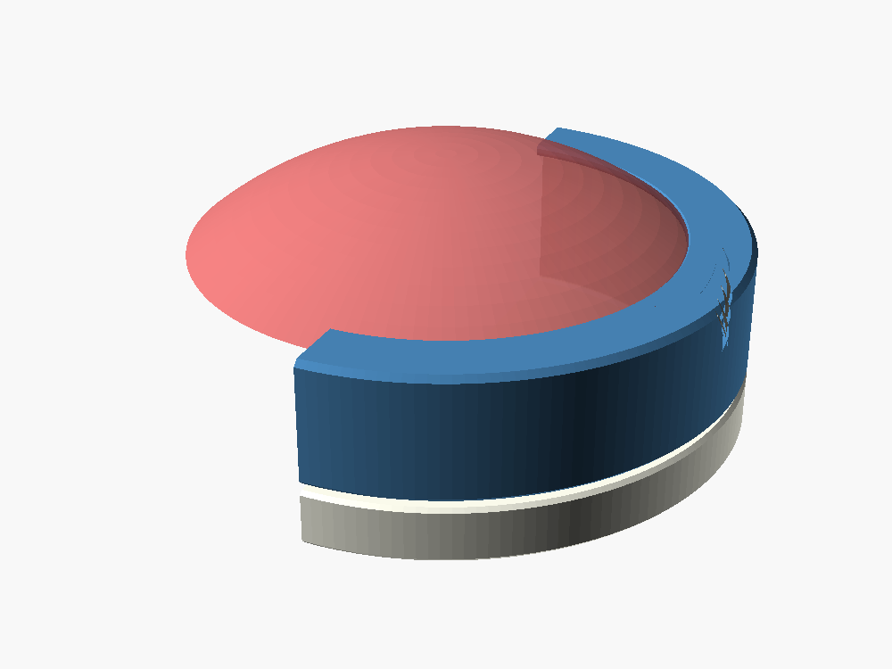
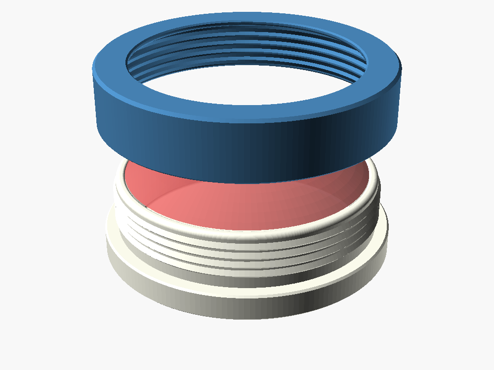

# Pincushion

> **Untested.** Version 1.2 has been checked in OpenSCAD (the meshes are
> clean and the parts fit on paper) but has not yet been printed or
> assembled. Expect the snap fit and the fabric pattern to need tuning.

A two-part pincushion with no sewing. A round **cup** is lined with steel
washers for weight, filled with batting mounded into a dome, and draped with
fabric cut from a printed pattern. A **cover** (a shroud with an inward lip)
is pressed down over it. Sawtooth ribs on the outside of the cup and the
inside of the cover nest together through the fabric and ratchet: easy on,
hard off. Nothing turns, so the fabric can't be twisted the way a screw-on
cover would twist it.

The lip clamps the fabric against the top of the cup's rim and hides its
edge; the ribs grip the tabs of fabric that run down the cup wall under the
cover. The fabric pattern is a disk with tabs, generated by the model to
match the cup, so the fabric lies flat down the wall instead of bunching.

|  |  |
|---|---|
| Cover and cup | Fabric pattern (default size, 117 mm across) |

## Files

| File | Purpose |
|---|---|
| `pincushion.scad` | The parametric model (OpenSCAD, no libraries) |
| `stl/pincushion_cup.stl` | Cup at the default settings, upright as it prints |
| `stl/pincushion_cover.stl` | Cover at the default settings, lip-down as it prints |
| `pattern/pincushion_pattern.svg` | Fabric pattern for the default settings, true size |
| `examples/` | Sample artwork (a thread spool and a pin) |
| `docs/USERS_GUIDE.md` | How it works, settings, printing, assembly |
| `images/` | OpenSCAD renders |
| `LICENSE` | MIT License |

## Quick start

1. Print the cup upright and the cover lip-down, no supports. PETG is
   recommended for the cover, which has to stretch about 2% to pass the ribs.
2. Print `pattern/pincushion_pattern.svg` at 100% and cut the fabric from it.
   It is sized for quilting cotton about 0.35 mm thick.
3. Line the cup floor with up to two layers of seven 3/8" USS washers (about
   95 g), fill with batting mounded about 14 mm above the rim, lay the fabric
   over it, pull the tabs down the cup wall, and press the cover on.

The [User's Guide](docs/USERS_GUIDE.md) covers fabric thickness, dome
height, the snap-fit settings, artwork on the cover and under the cup, and
what to adjust after a test print.

## Status

Version 1.2, untested. 1.0 was the first model: cup, ribbed cover and
pattern generator. 1.1 added artwork: two SVG locations wrapped onto the
outside of the cover and one under the cup. 1.2 sizes the cup by its inside
diameter, 77.5 mm by default so a layer of seven 1"-OD washers fits on the
floor, and reports the washers' weight.

## Credits and license

Made at the request of Bob Drzyzgula, who came up with the cup-and-shroud
idea with interlocking ribs and asked for the washer weights and the artwork
locations. The design, the OpenSCAD model, this README and the User's Guide
were written by Claude (Anthropic) at his direction.

Released under the [MIT License](LICENSE).
