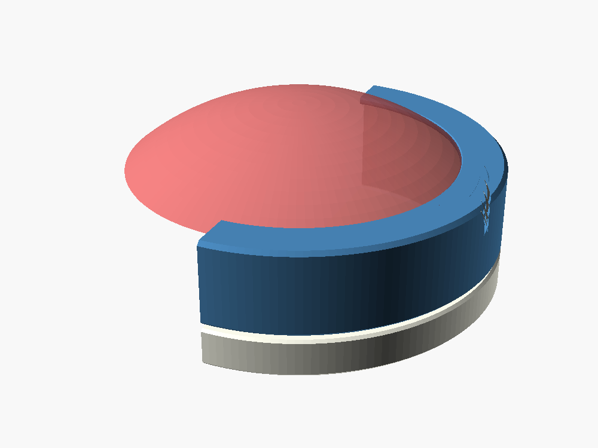
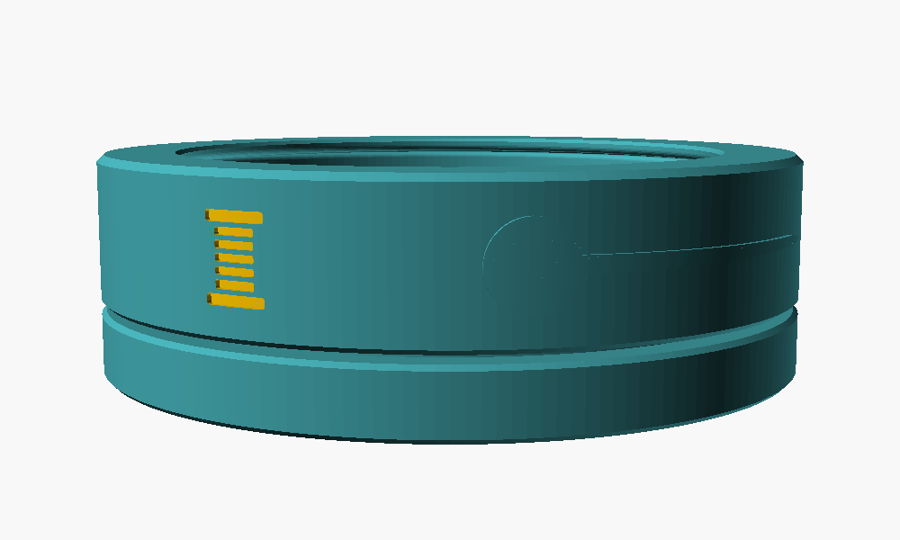
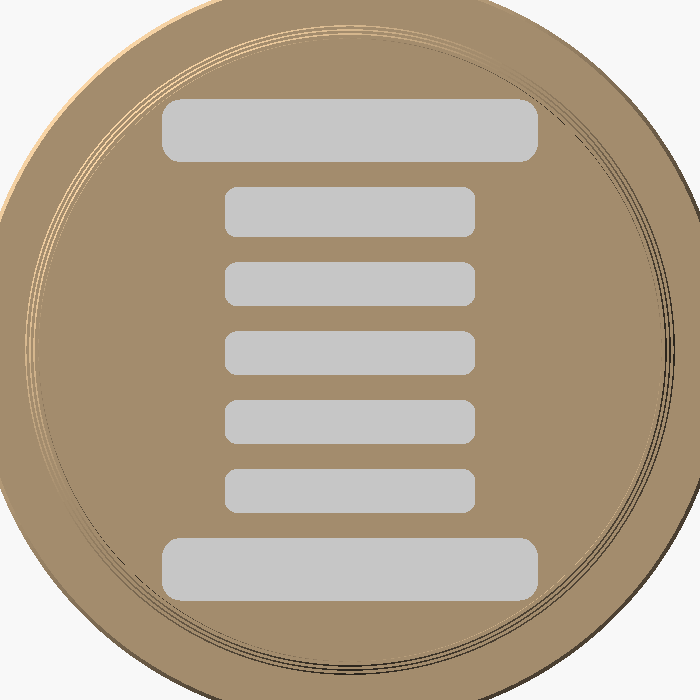

# Pincushion — User's Guide

Version 1.2 — **untested**: not yet printed or assembled.

The Pincushion was made at the request of Bob Drzyzgula. The design, the
OpenSCAD model and this guide were written by Claude (Anthropic) at his
direction.

## Contents

1. [What it is](#1-what-it-is)
2. [How it works](#2-how-it-works)
3. [The fabric pattern](#3-the-fabric-pattern)
4. [Printing](#4-printing)
5. [Assembly](#5-assembly)
6. [Artwork](#6-artwork)
7. [Settings reference](#7-settings-reference)
8. [Testing and tuning](#8-testing-and-tuning)
9. [Version history](#9-version-history)
10. [Credits and license](#10-credits-and-license)

## 1. What it is

A round pincushion made of two printed parts, a piece of fabric, batting,
and (optionally) steel washers for weight. No sewing is needed: the fabric
is held by the parts themselves.

- The **cup** holds the washers and the batting. Its outside carries rows of
  sawtooth ribs below the rim, and a plinth at the base.
- The **cover** is a ring with an inward lip at the top. Its inside carries
  matching ribs. Pressed down over the cup, it clamps the fabric and hides
  its edge.

At the default settings the finished pincushion is 92 mm across and about
40 mm tall to the top of the dome.



## 2. How it works

### The ribs


Each rib is an asymmetric sawtooth. Going on, the cover's ribs ride up a
gentle ramp (30° from vertical) on the cup's ribs; coming off, they meet a
steep 45° face. 45° is the steepest overhang that prints cleanly without
supports, in both parts, so that is the retaining angle.

The cup's ribs and the cover's ribs have the same profile, offset by a gap
equal to the fabric thickness plus 0.1 mm. When the cover is seated the
teeth nest together with the fabric between them, pinched hardest on the
45° faces, which are the ones that resist pulling the cover off.

With four rows, the cover works like a cable tie: it ratchets down a row at
a time, and pressing it down a further row takes up slack in the fabric.

The default ribs stand 0.9 mm proud. Seated, the teeth overlap by 0.45 mm.
Going on with fabric in place, the cover must stretch outward by about
0.8 mm on its radius, about 1.9% hoop strain. PETG takes that comfortably;
PLA is closer to its limit and more brittle, so PETG is recommended for the
cover. The cup can be either.

Threads were considered and rejected: turning a cover over the fabric would
wind it up.

### The lip and rim


The top of the cup's rim is flat, with rounded edges so the fabric isn't
cut. When the cover is seated, its lip sits one fabric thickness above the
rim and clamps the fabric there. The lip reaches 3 mm inside the cup's inner
wall, so it also presses down the edge of the dome and covers the cut ends
of the pattern's notches.

### The plinth

Below the cover, the cup steps out to a plinth the same diameter as the
cover, with a 1 mm reveal between them. The finished piece reads as a
drum in two bands.

### Washer weights

The cup's inside diameter defaults to 77.5 mm so that seven 1"-OD washers
fit flat on the floor in a hexagonal cluster (six around one), which needs
exactly three washer diameters, 76.2 mm. The corner where the floor meets
the wall is rounded by only 0.8 mm, less than a washer's thickness, so the
outer washers sit flat against the wall.

The washer settings don't add any geometry. They check that the washers fit
and report their weight and how much depth is left for batting:

```
Washers: 7 per layer need 76.2 mm across; cup ID 77.5 leaves 1.3 mm.
2 layer(s) = 14 washers, ~95 g; stack 4.2 mm, leaving 19.4 mm of cup depth for batting
```

The defaults are 3/8" USS flat washers: 1.000" OD, 0.438" ID, 0.083" thick.

## 3. The fabric pattern


The fabric has to cover the dome, go over the rim, and run down the cup wall
under the cover. Two things make it want to bunch:

- **The wall.** A plain circle that wraps down a cylinder has 2π mm too much
  fabric around the cup for every millimeter it goes down. The default
  13.5 mm of tab would carry about 85 mm of extra fabric. The pattern cuts
  that away as V-notches between tabs. The notches start under the lip, so
  they don't show, and the tabs lie flat on the wall.
- **The dome.** A dome is curved two ways, so no flat piece of fabric fits
  it exactly. At the default dome (14 mm high over a 77.5 mm opening), the
  fabric is about 8.5% too big around at the edge. Woven fabric takes that
  up by stretching on the bias, and what's left is clamped under the lip. A
  lower dome means less of it; a knit or wool felt hides it completely. The
  console reports the figure for your settings.

To make a pattern for your settings, set **part** to *Fabric pattern*,
render (F6), and export as SVG or DXF. The SVG is in millimeters: print it
at 100% (actual size, no fit-to-page) and check one dimension with a rule.
`pattern/pincushion_pattern.svg` is the pattern for the default settings.

The pattern shrinks the dome portion by `taut_pct` (2%) so the top comes
out taut rather than slack. Grain direction doesn't matter much on a circle;
the dome will take its stretch from the bias wherever it falls.

## 4. Printing

| Part | Orientation | Notes |
|---|---|---|
| Cup | Upright, as exported | No supports. The rib undersides are 45° overhangs. |
| Cover | Lip down on the plate, as exported | No supports. The lip's top face prints on the plate, so it takes the plate's finish. |

Use PETG for the cover. Ordinary settings work: 0.2 mm layers, three or
more walls on the cover so the ribs and the band behind them are solid.

For multi-color artwork (section 6), set **part** to *Cup* or *Cover* and
export 3MF with OpenSCAD's lazy union turned on; the artwork comes out as
its own colored object. For STL, export the *without artwork* and
*artwork only* parts separately.

## 5. Assembly

1. **Measure the fabric.** Squeeze a double layer of it in calipers, halve
   the reading, and set `fabric_t` to that before printing. The rib gap is
   built around it. Quilting cotton is about 0.35 mm.
2. **Cut the fabric** from the pattern.
3. **Washers.** Lay up to two layers of seven washers on the cup floor.
4. **Batting.** Fill the cup and mound it about 14 mm (the `dome_h`
   setting) above the rim. Wool roving is the traditional filling; polyester
   fiberfill works.
5. **Drape** the fabric over the batting, centered, and pull the tabs down
   the cup wall evenly all round. A hair elastic around the tabs, low on the
   wall, holds them while you start the cover.
6. **Press the cover on.** Start it level, push it down until the lip meets
   the fabric on the rim, then pull out the elastic if you used one and
   press the cover fully home.

The cover isn't meant to come off again. If it must, work it up evenly
around the circumference.

## 6. Artwork



There are three artwork locations, each taking an SVG file.

**Cover, locations 1 and 2.** The artwork is wrapped onto the cylinder of
the cover, not projected flat. (Flat art would sit about 2.5 mm deep at the
edges of a 40 mm-wide design.) Each location has its own file, mode, angle
around the cover (0° and 180° by default), height, width, vertical shift and
rotation. With height at 0, the art is 60% of the plain band on the cover,
about 10 mm at the default size; the console reports the band height.

- *Engrave* cuts the art into the wall.
- *Inlay* cuts it in and makes a flush artwork solid to print in a second
  color. Because the cover's wall is vertical as it prints, an inlay means
  a filament change on every layer the art spans, about 50 changes for
  10 mm-tall art. Engrave or raise is much cheaper.
- *Raise* stands the art proud of the wall. Its bottom edges print as small
  overhangs.

The wrap is built from flat strips `side_strip` wide (0.5 mm by default);
smaller is smoother and slower.

**Bottom.** Under the cup, engraved or inlaid only, since it prints on the
plate. It is mirrored so it reads correctly from underneath, and the floor
is thickened by the artwork's depth. Here an inlay costs only a few
first-layer color changes.



Two sample files are in `examples/`: a thread spool and a ball-head pin
drawn wide for the cover band.

## 7. Settings reference

### Part

| Setting | Values |
|---|---|
| `part` | Previews: *assembled*, *cutaway*, *half cross-section (2D)*. Printing: *Cup*, *Cover*, the same without artwork, the artwork solids alone, *Cup and cover together*. *Fabric pattern* (2D, export SVG/DXF). |

### Size

| Setting | Default | Meaning |
|---|---|---|
| `cup_id` | 77.5 | Inside diameter of the cup |
| `cup_h` | 26 | Cup height, base to rim |
| `wall` | 3.0 | Cup wall thickness |
| `floor_t` | 2.4 | Cup floor thickness |
| `floor_round` | 0.8 | Rounding of the inside floor corner; keep it below the washer thickness |

### Washer weights

| Setting | Default | Meaning |
|---|---|---|
| `washer_layers` | 2 | Layers of washers on the floor (0 = none) |
| `washer_od`, `washer_id`, `washer_t` | 25.4, 11.1, 2.1 | Washer size (3/8" USS) |
| `washers_per_layer` | 7 | 7 (hexagonal cluster) or 1 |

### Fabric and dome

| Setting | Default | Meaning |
|---|---|---|
| `fabric_t` | 0.35 | Compressed fabric thickness |
| `dome_h` | 14 | Planned height of the batting dome above the rim |
| `tabs` | 12 | Number of tabs in the pattern |
| `tab_fill` | 0.88 | Fraction of the cup's circumference the tabs cover; below 1 so they never overlap |
| `taut_pct` | 2 | Percent the dome part of the pattern is shrunk so the top is taut |
| `tab_margin` | 1.5 | How far above the bottom of the cover the tabs end |
| `tab_round` | 2 | Rounding of the tab corners |

### Snap ribs

| Setting | Default | Meaning |
|---|---|---|
| `rib_rows` | 4 | Rows of ribs |
| `rib_h` | 0.9 | How far each rib stands out |
| `rib_pitch` | 3.0 | Vertical spacing of the rows |
| `lead_angle` | 30 | Lead-in ramp, from vertical (smaller is easier on) |
| `ret_angle` | 45 | Retaining face, from horizontal |
| `rib_clear` | 0.10 | Clearance added to the fabric thickness between nested teeth |

`fabric_t + rib_clear` must be less than `rib_h`, or the teeth won't
interlock; the model stops with a message if it isn't.

### Cover

| Setting | Default | Meaning |
|---|---|---|
| `cover_wall` | 3.0 | Cover wall thickness outside the ribs |
| `lip_t` | 2.0 | Lip thickness |
| `lip_reach` | 3.0 | How far the lip reaches inside the cup's inner wall |
| `skirt_extra` | 2.0 | Plain skirt below the last row of ribs |
| `reveal` | 1.0 | Gap between the cover and the plinth when seated |

### Details

| Setting | Default | Meaning |
|---|---|---|
| `rim_round_o`, `rim_round_i` | 1.5, 0.8 | Rounding of the rim's outer and inner edges |
| `rim_land` | 1.0 | Plain band between the rim rounding and the first rib |
| `chamfer` | 0.6 | Edge chamfers |
| `explode` | 0 | Lifts the cover in the assembled preview |

### Artwork

| Setting | Default | Meaning |
|---|---|---|
| `side1_mode`, `side2_mode` | none | none, engrave, inlay or raise |
| `side1_file`, `side2_file` | examples/spool.svg | SVG file, relative to the model |
| `side1_angle`, `side2_angle` | 0, 180 | Where around the cover the art is centered |
| `side*_height` | 0 | Art height (0 = 60% of the band) |
| `side*_width` | 0 | Width along the curve (0 = keep proportions) |
| `side*_z_shift` | 0 | Up (+) or down (−) from the middle of the band |
| `side*_rotate` | 0 | Rotation of the art |
| `side_depth` | 0.6 | Engrave/inlay depth or raised height |
| `side_strip` | 0.5 | Width of the strips the wrap is built from |
| `bottom_mode` | none | none, engrave or inlay |
| `bottom_file` | examples/spool.svg | SVG file |
| `bottom_width`, `bottom_height` | 0, 0 | Size (0 width = 55% of the cup's outside diameter; 0 height = keep proportions) |
| `bottom_rotate` | 0 | Rotation |
| `bottom_depth` | 0.6 | Engrave/inlay depth; the floor is thickened by this |

### Console report

Every render reports the overall sizes, the rib engagement and hoop strain,
the pattern's diameter and tab size, the dome's excess circumference, the
cover's art band, and the washer fit and weight.

## 8. Testing and tuning

This design hasn't been printed yet. Things to look at on the first one:

| What you see | What to change |
|---|---|
| Cover too hard to press on, or it cracks | Lower `rib_h`, or print the cover in PETG |
| Cover pulls off too easily | Raise `rib_h` or `rib_rows` |
| Fabric slack on top | Raise `taut_pct`, or press the cover down another row |
| Fabric wrinkled at the edge of the dome | Lower `dome_h`, or use a knit or felt |
| Tabs overlap on the cup wall | Lower `tab_fill` or raise `tabs` |
| Tabs don't reach far enough down the wall | Lower `tab_margin` |
| Notches show beyond the lip | Raise `lip_reach` |
| Thick fabric (felt) | Set `fabric_t` to its squeezed thickness and raise `rib_h` to suit |

## 9. Version history

- **1.2** (untested): the cup is sized by its inside diameter, 77.5 mm by
  default, to fit seven 1"-OD washers per layer; the inside floor corner is
  rounded less; washer fit, weight and remaining depth are reported.
- **1.1** (untested): artwork, two locations wrapped onto the cover and one
  under the cup; the cover is turned over for printing rather than mirrored.
- **1.0** (untested): cup, ribbed snap-on cover and fabric pattern generator.

## 10. Credits and license

Made at the request of Bob Drzyzgula, who came up with the cup-and-shroud
idea with interlocking ribs and asked for the washer weights and the artwork
locations. The design, the OpenSCAD model and this guide were written by
Claude (Anthropic) at his direction.

Released under the [MIT License](../LICENSE).
