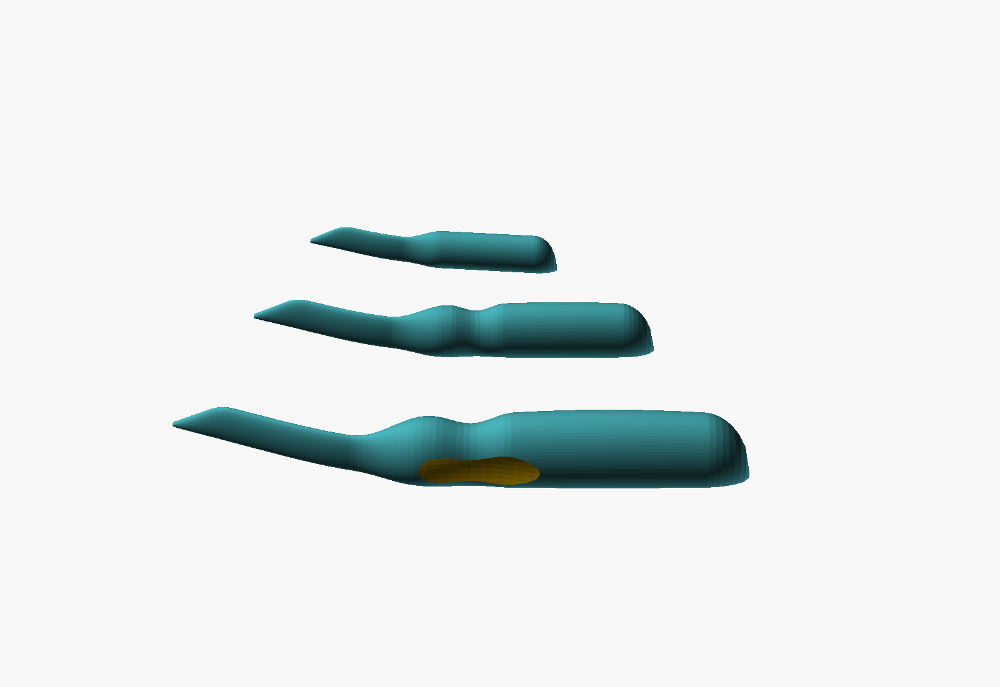
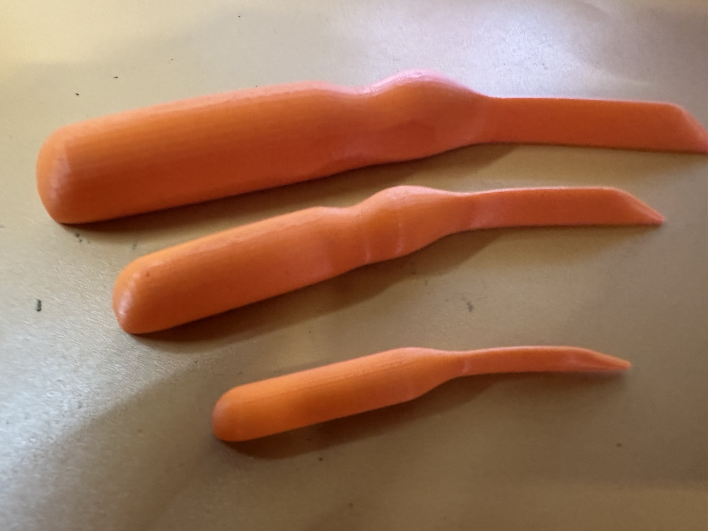

# Point Turner

A curved point turner: after a bag, pillow, collar or cuff has been turned
right side out, you push its blunt point into each corner from the inside
to bring the corner out crisp and square. It comes in three sizes:

| Size | Length | Grip | For |
|---|---|---|---|
| Small | 76 mm (3 in) | 9 × 11.5 mm, plain | Tight pockets, small bags, collar points; held in the fingertips |
| Medium | 114 mm (4½ in) | 12 × 15 mm, finger groove | General use |
| Large | 152 mm (6 in) | 15 × 19 mm, finger groove, pinch pads, palm swell | Tote bags, cushions, deep corners |

All three share the same tip, a 1.6 mm blunt nub on a 35° point, because a
corner doesn't get bigger when the tool does. What grows with the size is
the reach from the tip to the grip, and the grip itself. The larger tools
have room for more ergonomic shaping, and they get it.

The blade is flat, with its broad face in the plane of the work. It bends
20° (15° on the small) through the neck, across its thickness, so with
the tip in a corner the handle rises off the table and clears your
knuckles. The grip is a slight oval lined up with the blade, so you can
feel which way the blade faces without looking.

## Files

| File | Purpose |
|---|---|
| `point_turner.scad` | The parametric model (OpenSCAD, no libraries) |
| `stl/point_turner_small.stl` | Ready-to-print small, at the default settings |
| `stl/point_turner_medium.stl` | Ready-to-print medium |
| `stl/point_turner_large.stl` | Ready-to-print large |
| `stl/point_turner_set.stl` | All three on one plate |
| `stl/point_turner_set_left.stl` | All three, left-handed |
| `stl/point_turner_large_creaser.stl` | Large with a creaser paddle and 5 mm hanging hole |
| `docs/USERS_GUIDE.md` | The shape, the sizes, settings, printing and use |
| `images/` | OpenSCAD renders |
| `LICENSE` | MIT License |

## Quick start

1. Print the STL for the size you want (or the set) as it comes, lying on its
   side. No supports, and no brim needed. Fine layers (0.12 mm) give the
   smoothest grip. PLA works well; PETG is tougher.
2. Turn the piece right side out. Slip the point in through the opening
   and push it gently into each corner, so the seam allowance folds inside
   and the corner comes out to a point.

The [User's Guide](docs/USERS_GUIDE.md) covers the settings, including a
left-handed version, a custom size, a straight version, a flat creaser
paddle beyond the grip, and a hanging hole.

## Status

Version 1.5. The design is settled: all nine creaser versions (every size
and hand) printed cleanly in PETG with no brim or mouse ears. 1.1 added a
left-handed version; 1.2 widened the foot under thin sections, and a plate
of 1.2 tools printed cleanly in PETG with no brim or mouse ears; 1.3 adds
the creaser paddle beyond the full grip rather than in place of its end,
so its corner stays out of the palm; 1.4 adds a straight option to `hand`;
1.5 can lay out all nine sizes and hands at once. Version 1.0: all three
sizes printed as the set in PLA, at 0.12 mm layers with gyroid infill and
`$fn` at 200: they come out smooth and sit well in the hand.

## Credits and license

Made at the request of Bob Drzyzgula, who set the three sizes and asked
for a curved tool that's easy to hold. The design, the OpenSCAD model, this
README and the User's Guide were written by Claude (Anthropic) at his
direction.

Released under the [MIT License](LICENSE).
