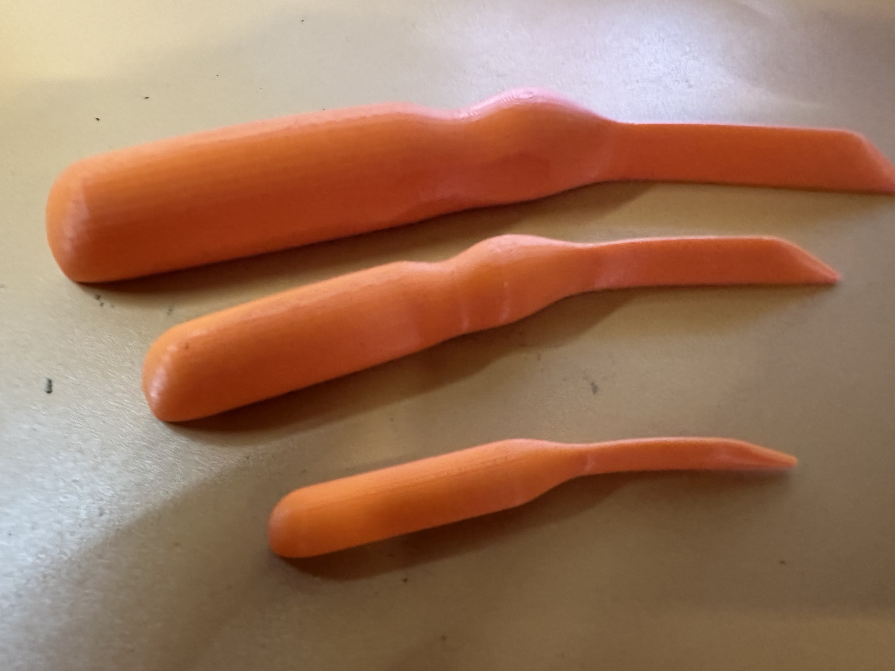
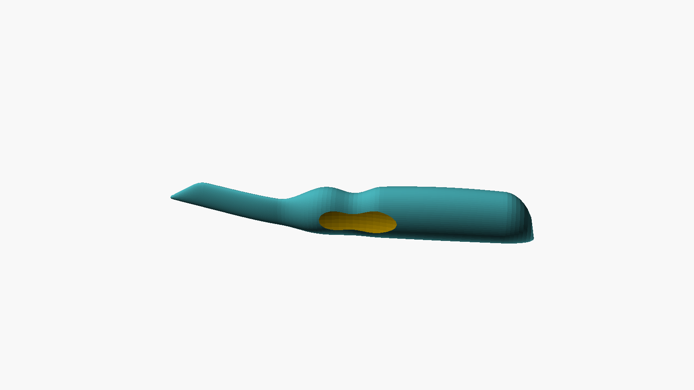
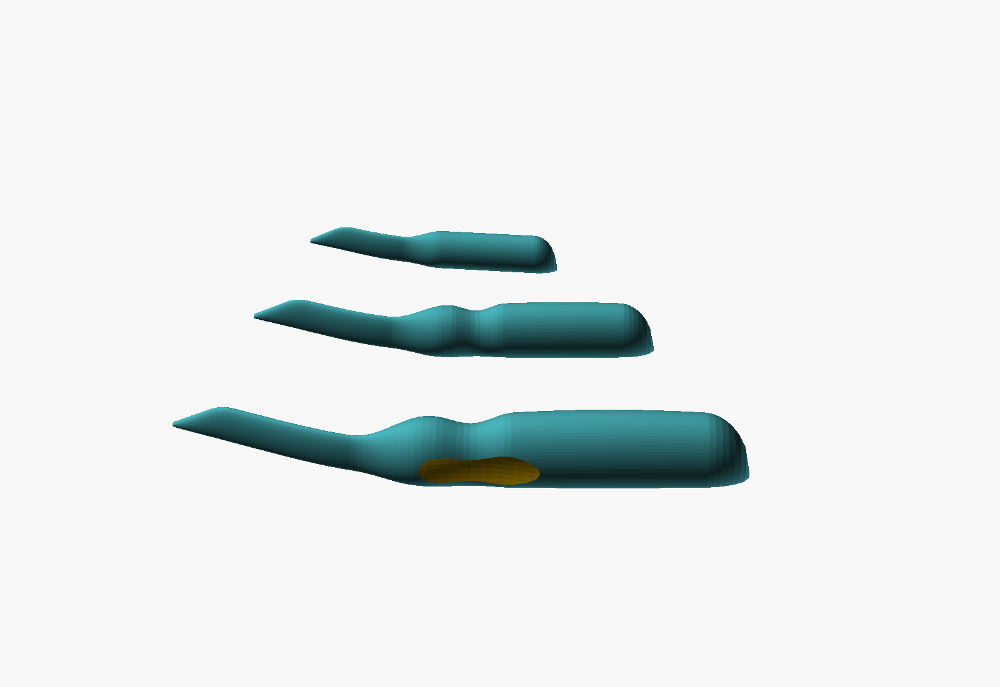
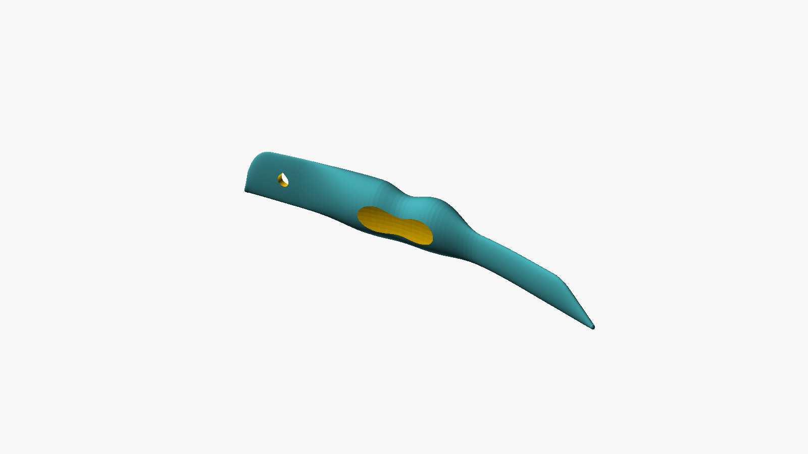

# Point Turner — User's Guide

Version 1.0

The Point Turner was made at the request of Bob Drzyzgula. The design, the
OpenSCAD model and this guide were written by Claude (Anthropic) at his
direction.

## Contents

1. [What it is](#1-what-it-is)
2. [The shape](#2-the-shape)
3. [The three sizes](#3-the-three-sizes)
4. [Using it](#4-using-it)
5. [Printing](#5-printing)
6. [Settings reference](#6-settings-reference)
7. [Troubleshooting](#7-troubleshooting)
8. [Version history](#8-version-history)
9. [Credits and license](#9-credits-and-license)

## 1. What it is

When a bag, pillow, collar or cuff is sewn inside out and turned right side
out, its corners come out rounded and stubby, with the seam allowance
bunched up inside. A point turner is a blunt, pointed stick that you work
into each corner from the inside to push the corner fully out. It's an old
and simple tool: bone, wood, bamboo and plastic ones have been sold for
generations.

This one is curved, comes in three sizes, and prints in one piece with no
supports.

## 2. The shape

From the working end back:

- **The tip** is a small blunt nub, 1.6 mm across, rather than a sharp
  point. It reaches well into a corner but won't easily pierce the fabric or
  split the seam.
- **The point**, seen face-on, has one straight edge and one edge that
  slopes in at 35°. The straight edge is the one that lies on the print
  bed. It also gives you a straight edge to run along a seam line. The point
  is sharper than the 90° corner of a bag and narrow enough for most collar
  points. Its thickness tapers over about 22 mm from the nub up to the full
  blade, so it slides between the layers of folded seam allowance.
- **The blade** is flat. Its broad face lies in the plane of the work.
- **The bend.** The tool bends through the neck, between the blade and the
  grip, across the blade's thickness. With the blade lying in a corner, the
  handle rises off the table. The blade and the grip are each straight; the
  bend is all in the neck.
- **The grip** is an oval lined up with the blade, so your fingers can tell
  which way the blade faces. On the medium and large it starts with a
  front swell (a finger stop), then a waist where your thumb and finger
  pinch it, then the body of the grip.
- **The butt** is rounded to sit in your palm. It can be made instead as a
  thin rounded **creaser** paddle for finger-pressing seams open (see
  [section 6](#6-settings-reference)).

The cross-section everywhere is an oval sitting on a narrow flat, with its
lower sides running into the flat at 45°. That flat is what the tool
stands on when it prints, and it shows along one edge of the finished tool.

## 3. The three sizes

Making all three sizes the same shape and changing only the length was an
option. It doesn't work well, for two reasons:

- **The tip must stay the same size.** A corner is the same size whatever
  tool you push into it, so a scaled-up tip would only be worse at its job.
  All three sizes have the same tip, point angle and taper.
- **A grip has to fit a hand, not the tool.** A 3-inch tool is held in the
  fingertips like a pencil stub, and a groove or a palm swell has no room
  to do anything. A 6-inch tool is held in the whole hand, and shaping its
  grip pays off.

So the three sizes are one family, scaled where scaling helps:

| | Small | Medium | Large |
|---|---|---|---|
| Overall length (straight, end to end) | 76 mm (3 in) | 114 mm (4½ in) | 152 mm (6 in) |
| Reach, tip to grip | 30 mm | 42 mm | 52 mm |
| Blade, thickness × face width | 3.0 × 9 mm | 3.5 × 11 mm | 4.0 × 12 mm |
| Grip, thickness × height | 9 × 11.5 mm | 12 × 15 mm | 15 × 19 mm |
| Bend | 15° | 20° | 20° |
| Finger groove | — | 1.0 mm deep | 1.3 mm deep |
| Pinch pads | — | — | 0.8 mm deep, both faces |
| Palm swell | — | 1.0 mm | 2.0 mm |
| Printed size (L × W × H) | 76 × 17 × 11.5 mm | 114 × 31 × 16 mm | 152 × 41 × 21.5 mm |
| Weight, solid PETG | about 5 g | about 14 g | about 32 g |

The pinch pads on the large are shallow dished flats on the two faces of
the waist. Your thumb finds one and your middle finger the other, which
helps you keep the blade turned the right way.

If none of the three suits you, set `size` to `custom` and set every
dimension yourself (see [section 6](#6-settings-reference)). For larger
hands, a custom size based on the large with a thicker grip is the place to
start.

## 4. Using it

1. **Trim and clip first.** Before turning, trim the seam allowance at
   each corner. Clip the tip of the corner off at an angle, without cutting
   the stitching, so there's less fabric to fold inside the point.
2. **Turn the piece right side out.**
3. **Find the corner.** Slip the tool in through the opening with the
   blade flat between the two layers, and slide it along the seam until the
   tip reaches the corner.
4. **Push it out.** Press the tip gently into the corner and work it
   slightly from side to side. The seam allowance folds inside and the
   corner comes out to a point. Don't force it: a blunt tip pushed hard
   enough will still go through.
5. **Shape the seams.** Run the straight edge of the blade along the inside
   of each seam to push it fully out before pressing.

Which way the bend goes: with the tip in a corner and the blade lying flat,
turn the tool so the handle rises away from the table. If it lies the other
way, flip it over.

## 5. Printing

- **Orientation:** as it comes from the model, lying on its side with the
  straight edge of the point on the bed. The bend lies flat on the bed. No
  supports.
- **Why on its side:** every extrusion line then runs along the tool, so
  pushing on the tip loads the plastic along its lines, not the bonds
  between layers. It also means the bend doesn't need support.
- **Brim:** each tool stands on a narrow flat (about 1 mm wide along the
  blade, a few millimeters along the grip). A brim of 3 to 5 mm holds it
  down, especially at the tip.
- **Material:** PETG is recommended. It's tough and flexes a little rather
  than snapping if you lean on the tip. PLA works but is more likely to
  break at the tip if levered.
- **Walls and infill:** with 3 or 4 walls the blade prints nearly solid.
  15 to 25% infill is plenty for the grip.
- **Layer height:** 0.12 mm layers make the curves of the grip smooth.
  The prototypes were printed that way, with `$fn` raised to 200.
- **Smoothing the tip:** a printed tip has small layer steps. Rub the point
  and the first 20 mm of the blade lightly with fine sandpaper (400 grit or
  finer), so it slides between the fabric layers without catching.
- **The set:** `stl/point_turner_set.stl` lays out all three on a 153 ×
  107 mm plate.

To make a size that isn't in the STLs, open `point_turner.scad` in
OpenSCAD, choose the settings in the Customizer (Window › Customizer),
render (F6) and export.

## 6. Settings reference

All dimensions are in millimeters.

### Size

| Setting | Default | Meaning |
|---|---|---|
| `size` | `medium` | `small`, `medium`, `large`, `custom` (uses the Custom settings below), or `all` (the three presets laid out on one plate) |

### Tip (the same for every size)

| Setting | Default | Meaning |
|---|---|---|
| `tip_d` | 1.6 | Diameter of the blunt nub. Smaller reaches tighter points but is likelier to push through a loose weave |
| `tip_angle` | 35 | Included angle of the point, seen face-on. Must be sharper than the corners you turn |
| `thick_taper` | 22 | Length over which the thickness grows from the nub to the full blade. Longer is a thinner, more gradual wedge |

### Bend

| Setting | Default | Meaning |
|---|---|---|
| `bend_deg` | −1 | Total bend in degrees. −1 uses the size's own (15° small, 20° medium and large); 0 makes a straight tool |
| `bend_start`, `bend_end` | 0.18, 0.55 | Where the bend begins and ends, as fractions of the length. Bringing them closer together makes a sharper elbow |

### Butt end

| Setting | Default | Meaning |
|---|---|---|
| `butt_style` | `round` | `round`: a domed end for the palm. `creaser`: the grip thins over its last few centimeters to a rounded paddle, for finger-pressing seams open |
| `creaser_t` | 2.6 | Thickness of the creaser paddle |
| `hang_hole_d` | 0 | Diameter of a hanging hole through the butt, side to side. 0 for none. It's printed with a pointed top so it needs no support; keep it at least 5 mm less than the grip height |

### Cross-section

| Setting | Default | Meaning |
|---|---|---|
| `flat_frac` | 0.5 | Width of the flat the tool stands on, as a fraction of the half-thickness. Larger is steadier on the bed and a plainer flat along the grip. Along the thin blade the flat is limited to what the 45° sides allow, whatever this is set to |

### Custom size (when `size = custom`)

| Setting | Default | Meaning |
|---|---|---|
| `c_length` | 114 | Overall length, straight end to end |
| `c_reach` | 42 | Tip to the start of the grip swell |
| `c_blade_t` | 3.5 | Blade thickness where the tip taper ends |
| `c_blade_h` | 11 | Blade face width |
| `c_grip_t` | 12 | Grip thickness (across the bend) |
| `c_grip_h` | 15 | Grip height (across the blade face); make it larger than `c_grip_t` to keep the oval lined up with the blade |
| `c_swell_len` | 16 | Length of the swell from blade to grip |
| `c_groove` | true | Finger groove at the front of the grip |
| `c_groove_depth` | 1.0 | Groove depth, all round |
| `c_groove_w` | 16 | Groove length |
| `c_pads` | false | Pinch pads on both faces of the waist |
| `c_belly` | 1.0 | Palm swell, extra thickness midway down the grip |
| `c_end_len` | 10 | Length of the rounding at the butt |
| `c_bend` | 20 | Bend, degrees (used when `bend_deg` is −1) |

### Plate and quality

| Setting | Default | Meaning |
|---|---|---|
| `plate_gap` | 6 | Gap between tools when `size = all` |
| `stations` | 90 | Cross-sections along the tool. More is smoother along its length |
| `$fn` | 64 | Points around each cross-section, and the smoothness of the pads and hanging hole. 200 is a good choice for a final print; renders take a few seconds |

## 7. Troubleshooting

**The tip lifts or curls during printing.** Add or widen the brim, and
slow the first layer. The tip is the smallest footprint on the part.

**The tip snags on the fabric.** Sand it smooth (see
[section 5](#5-printing)). If it still catches, increase `tip_d` to 2.0.

**It won't reach into a sharp collar point.** Reduce `tip_angle` to 25 to
30 and `tip_d` to 1.2, and sand the tip. Use the small size.

**The tip broke.** Print in PETG, and use more walls. Don't lever with the
tip; push straight along the blade.

**The handle sits the wrong way when the tip is in the corner.** Turn the
tool over: the bend is the same on both faces of the blade.

## 8. Version history

| Version | Date | Changes |
|---|---|---|
| 1.0 | November 2026 | First version: small, medium and large presets, custom size, creaser and hanging-hole options. All three printed at 0.12 mm layers with `$fn` 200 |

## 9. Credits and license

Made at the request of Bob Drzyzgula, who set the three sizes and asked for
a curved tool that's easy to hold. The design, the OpenSCAD model and this
guide were written by Claude (Anthropic) at his direction.

Released under the [MIT License](../LICENSE).
